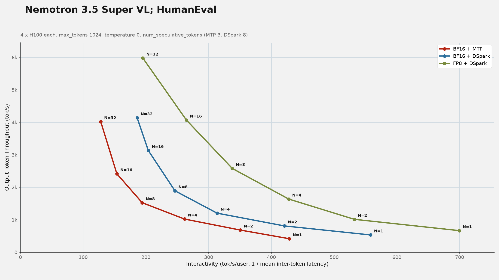
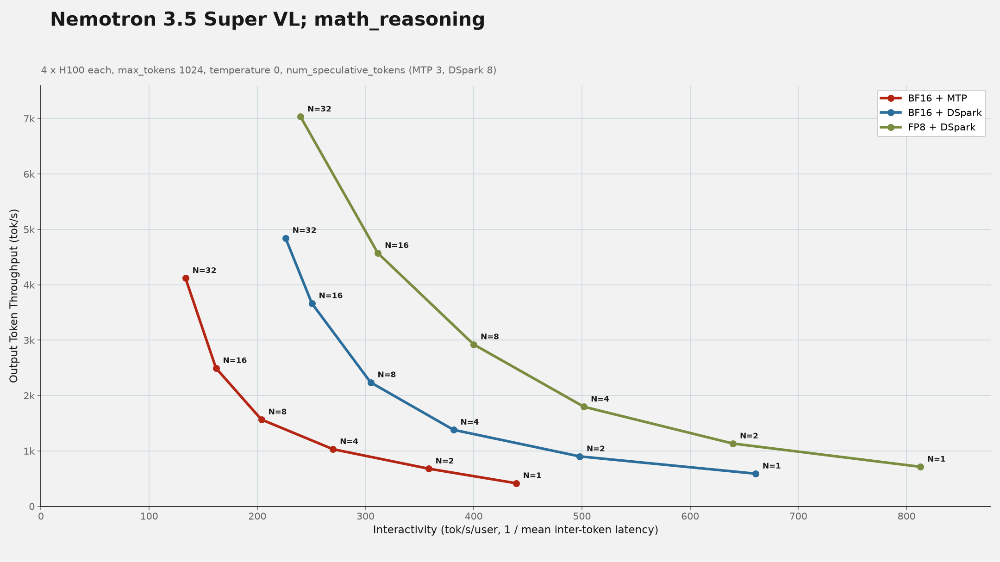

<div align="center">

 

[](https://github.com/vllm-project/speculators/blob/main/LICENSE) [](https://pypi.org/project/speculators/) [](https://docs.vllm.ai/projects/speculators/en/latest/) [](https://pypi.org/project/speculators/) [](https://buildkite.com/vllm/speculators)

</div>

<p align="center">
  <a href="README.md">English</a> · <b>简体中文</b>
</p>

## 项目概述 (Overview)

Speculators 是一个用于训练投机解码草稿模型（Speculative Decoding Draft Models）的算法库，训练所得模型可直接部署至 vLLM 等大语言模型推理引擎。投机解码是一种无损加速 LLM 推理的技术，它利用更小、更快速的草稿模型（即“投机者/推测器 Speculator”）预先推测候选词元（Tokens），再由规模更大的基座模型进行验证，从而在不降低输出质量的前提下显著降低推理延迟。投机者智能地提前生成多个候选词元，基座模型在单次前向传播中完成并行验证。由于每个被接受的词元都能保证与主模型独立生成的结果完全一致，因此该方法能在零损耗输出质量的同时大幅提升推理吞吐。

Speculators 将这一流程标准化，提供了生产级的端到端框架，支持通过可复用的格式与工具链训练草稿模型。训练完成的模型可无缝运行于 vLLM 中，助力在生产级推理集群中落地投机解码技术。

<p align="center">
  <picture>
    <source media="(prefers-color-scheme: dark)" srcset="https://raw.githubusercontent.com/vllm-project/speculators/main/docs/assets/branding/speculators-user-flow-dark.svg" />
    <source media="(prefers-color-scheme: light)" srcset="https://raw.githubusercontent.com/vllm-project/speculators/main/docs/assets/branding/speculators-user-flow-light.svg" />
    
  </picture>
</p>

______________________________________________________________________

💬 欢迎加入 [vLLM 社区 Slack](https://inviter.co/vllm-slack) 并在以下频道交流探讨疑问、心得或新想法：

- `#speculators`
- `#feat-spec-decode`

🎥 观看我们的 Office Hours 分享交流会：[视频回放](https://www.youtube.com/live/2ISAr_JVGLs) | [演示幻灯片 (Slides)](https://docs.google.com/presentation/d/1s4eAb7v-rdZt8smyULBJWGXjJXrgFTZWnwqYa2-h1l4/edit?slide=id.g3365e070742_6_0#slide=id.g3365e070742_6_0)

______________________________________________________________________

## 🚀 最新动态 (What's New!)

Speculators 迎来了多项重磅更新！如需深入了解，请查阅 [Speculators 官方文档](https://docs.vllm.ai/projects/speculators/en/latest/)。

亮点新特性包括：

- **基于 hs_connectors 的多节点在线训练**：新增 [`hs_connectors`](https://github.com/vllm-project/speculators/tree/main/hs_connectors) 插件包，提供可插拔后端用于跨节点在 vLLM 与训练器之间传输隐藏状态（Hidden States）。基于文件的后端适用于共享文件系统；在无共享存储的环境下，Mooncake 后端则利用分布式存储，赋能多节点规模下的在线投机者训练。
- **DSpark 训练算法**：新增对 DSpark 训练算法的支持。该算法在 DFlash 锚定分块草稿（Anchored-block Drafting）的基础上扩展了马尔可夫预测头（Markov Head，在块内使每个草稿位置以先前的词元为条件）以及置信度预测头（Confidence Head，预测每个位置的接受概率）。DSpark 检查点支持从现有 DFlash 检查点热启动。
- **P-EAGLE 训练支持**：新增对 [P-EAGLE 训练算法](https://docs.vllm.ai/projects/speculators/en/latest/user_guide/algorithms/peagle)的支持。该算法通过基于条件分布采样（Conditional-On-Distribution, COD）的并行多词元预测拓展了 EAGLE-3 架构。P-EAGLE 无需串行生成草稿词元，而是在单次前向传播中并行预测多个词元，有效降低了起草延迟。红帽（Red Hat）团队已发布针对 [Qwen3-8B 的 P-EAGLE 投机模型](https://huggingface.co/RedHatAI/Qwen3-8B-speculator.peagle)。
- **MTP 微调支持**：新增对基于领域特定数据微调原生多词元预测（Multi-Token Prediction, MTP）头的支持（如 Qwen3-Next 模型），遵循 [FastMTP](https://arxiv.org/abs/2509.18362) 方案。由于 MTP 预测头参数量极小（约 100M–400M 参数），可直接在预先提取的隐藏状态上训练，无需加载完整验证器模型。
- **DFlash 与 DSpark 的滑动窗口注意力机制**：DFlash 与 DSpark 投机模型默认在所有草稿层启用滑动窗口注意力（Sliding Window Attention）。使用 `--sliding-window` 可设置窗口大小，使用 `--full-attention-indices` 可指定特定层保留全量注意力。滑动窗口注意力大幅减少了长上下文序列的 KV 缓存分配，且相比全量注意力可提升每位置的接受率。
- **DFlash 训练算法**：新增对带有锚定分块起草机制的 DFlash 训练算法支持，利用来自多个验证器层的辅助隐藏状态。包含用于设置块大小和最大锚点数的 CLI 选项，以及 DFlash 指标、实用工具与草稿模型。自 [vLLM PR #38300](https://github.com/vllm-project/vllm/pull/38300) 起，通过 Speculators 训练的 DFlash 模型已可在 vLLM 中无缝部署运行。

______________________________________________________________________

## 核心特性 (Key Features)

- **基于 vLLM 的离线训练数据生成**：支持使用 vLLM 生成隐藏状态数据。样本保存至本地磁盘，可用于草稿模型的离线训练。
- **全流程草稿模型训练支持**：提供单层与多层草稿模型的端到端训练支持，广泛支持 MoE、Dense（非 MoE）以及视觉语言大模型（VLM）。
- **标准化、可扩展的格式规范**：提供与 Hugging Face 完全兼容的投机模型定义格式，并配备将外部前沿研究仓库快速转换为标准 speculators 格式的工具链，极大降低落地门槛。
- **无缝集成 vLLM**：专为直接部署至 vLLM 而设计，以极低的额外开销实现低延迟、生产级的高性能推理。

> [!TIP]
> 欢迎阅读该篇 [vLLM 官方博客文章](https://blog.vllm.ai/2025/12/13/speculators-v030.html)，深入了解 Speculators 的各项前沿特性。

## 支持模型 (Supported Models)

访问 [Speculators 仪表板](https://neuralmagic.github.io/speculators-dashboard/) 浏览已训练的各类投机模型及其基准评测结果。

## vLLM 推理部署 (vLLM Inference)

通过 Speculators 训练的模型可通过简单的 `vllm serve <speculator_model>` 命令直接在 vLLM 中无缝运行。该命令将使用模型 `config.json` 中 `speculator_config` 定义的默认参数在 vLLM 中加载运行。

```bash
vllm serve RedHatAI/Qwen3-8B-speculator.eagle3
```

### 性能基准评测 (Performance Benchmarking)

服务启动后，可借助 [`scripts/evaluate`](https://github.com/vllm-project/speculators/tree/main/scripts/evaluate) 中的评测工具链使用 [GuideLLM](https://github.com/vllm-project/guidellm) 进行系统性基准测试。下方展示了在 Hopper GPU 上，针对 [NVIDIA-Nemotron-3.5-Super-VL-120B-A12B-BF16](https://huggingface.co/nvidia/NVIDIA-Nemotron-3.5-Super-VL-120B-A12B-BF16) 搭配已训练的 DSpark 投机模型 [RedHatAI/NVIDIA-Nemotron-3.5-Super-VL-120B-A12B.dspark](https://huggingface.co/RedHatAI/NVIDIA-Nemotron-3.5-Super-VL-120B-A12B.dspark) 的基准评测结果示例，并展示了将其与量化版 FP8 验证器 [RedHatAI/NVIDIA-Nemotron-3.5-Super-VL-120B-A12B-FP8](https://huggingface.co/RedHatAI/NVIDIA-Nemotron-3.5-Super-VL-120B-A12B-FP8) 结合后的进一步加速效果。

<p align="center">
  
</p>

<p align="center">
  
</p>

## 附加实用脚本 (Additional Utility Scripts)

- [重新生成回复以增强训练数据](https://github.com/vllm-project/speculators/tree/main/scripts/response_regeneration)

## 快速开始 (Getting Started)

### 安装指南 (Installation)

#### 环境要求 (Prerequisites)

安装前请确保满足以下环境要求：

- **操作系统**：Linux 或 macOS
- **Python**：3.11 或更高版本
- **包管理器**：pip（推荐）或 conda

#### 从 PyPI 安装（推荐）

从 PyPI 安装最新稳定发布版：

```bash
pip install speculators
```

#### 源码编译安装

安装最新开发版本或参与项目贡献：

```bash
git clone https://github.com/vllm-project/speculators.git
cd speculators

pip install -e .
```

安装包含开发工具链的完整开发环境：

```bash
pip install -e ".[dev]"
```

#### 验证安装

您可以通过检查版本号来验证安装是否成功：

```bash
speculators --version
```

或在 Python 中导入模块进行验证：

```python
import speculators
print(speculators.__version__)
```

## 开源许可证 (License)

Speculators 遵循 [Apache License 2.0](https://github.com/vllm-project/speculators/blob/main/LICENSE) 开源许可证。

## 学术引用 (Cite)

如果您在研究或项目中使用了 Speculators，欢迎引用如下文献：

```bibtex
@misc{speculators2025,
  title={Speculators: A Unified Library for Speculative Decoding Algorithms in LLM Serving},
  author={Red Hat},
  year={2025},
  howpublished={\url{https://github.com/vllm-project/speculators}},
}
```

---

> **翻译说明（Translation Disclaimer）**
> 本文档由社区志愿者（[@JasonYeYuhe](https://github.com/JasonYeYuhe)）人工翻译并维护，旨在降低中文开发者的阅读门槛。最后同步日期：2026年10月31日。若译文与英文原版存在任何出入或滞后，请以 [英文原版 (README.md)](README.md) 为准。欢迎通过 PR 协助改进译文！
