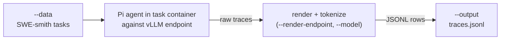

# generate-agentic-traces

Generates agentic execution traces with [Pi](https://github.com/badlogic/pi-mono) and converts them into speculator-format training rows.

For each task in a SWE-smith-style dataset, a Pi agent runs inside the task container and works against a vLLM-served target model, producing a raw trace of its tool calls and observations. Each trace is then rendered and tokenized into rows with `input_ids` and `loss_mask`, ready for `speculators train`.



## Prerequisites

- The optional agent runtime: `pip install 'speculators[agentic]'`. The Docker SDK is imported lazily, so the command (and its `--help`) works without it until a task is actually run.
- A running vLLM server serving the target model, reachable from the host (used for rendering/tokenization) and from inside the task container (used by the agent). The server must be started with `--enable-scale-out`: the render step calls `/v1/chat/completions/render`, which otherwise returns `403` with `"Scale-out endpoints are disabled. Restart vllm serve with --enable-scale-out to enable them."`.
- A prepared Pi runtime directory (`--pi-runtime`).
- A container runtime able to start the SWE-smith task images. Missing task images are pulled on first use.

## Basic Usage

```bash
speculators generate-agentic-traces \
  --model Qwen/Qwen3-32B \
  --data ./swe_smith_tasks.jsonl \
  --render-endpoint http://localhost:8000 \
  --pi-runtime ./pi-runtime \
  --output ./traces.jsonl
```

## Arguments

### Data Arguments

- **`--model`** (str, required) HuggingFace model ID or local path for the target model. Used to load the tokenizer/processor that converts traces into rows.

- **`--data`** (str, repeatable, required) SWE-smith-style task datasets: a local JSON/JSONL file, a directory of them, a HuggingFace dataset id, or a `hf:` prefixed id.

- **`--limit`** (int, default: `None`) Run at most N tasks.

- **`--max-samples`** (int, default: `None`) Write at most N output rows.

### Agent Arguments

- **`--pi-runtime`** (str, required) Path to the prepared Pi runtime.

- **`--pi-endpoint`** (str, default: `http://host.docker.internal:8000/v1`) OpenAI-compatible endpoint as seen from *inside* the task container.

- **`--pi-provider`** (str, default: `vllm`) Pi provider name.

- **`--pi-model`** (str, default: `qwen3.8-27b`) Model name exposed to Pi by that endpoint.

- **`--tools`** (str, default: `read,bash,edit,write`) Comma-separated list of tools enabled for the agent.

- **`--workers`** (int, default: `4`) Number of tasks run concurrently.

- **`--timeout`** (int, default: `900`) Per-task timeout in seconds.

### Rendering and Output Arguments

- **`--render-endpoint`** (str, required) Base URL of the vLLM server used to render traces (e.g. `http://localhost:8000`).

- **`--seq-length`** (int, default: `32768`) Maximum sequence length of an output row.

- **`--output`** (str, required) Output JSONL path, e.g. `traces.jsonl`. Parent directories are created.

- **`--trace-dir`** (str, default: `<output>.traces`) Directory holding the raw traces.

- **`--keep-traces` / `--no-keep-traces`** (default: keep) Keep the raw trace directory after conversion.

## Output Format

Rows are in speculator format, one row per training segment of a trace:

```json
{
  "id": "instance-abc_0",
  "primary_id": "instance-abc",
  "input_ids": [151644, 872, ...],
  "loss_mask": [0, 0, ..., 1, 1],
  "text": "<|im_start|>user\n...<|im_end|>\n<|im_start|>assistant\n...",
  "metadata": {}
}
```

- `primary_id` is the task's instance id; `id` is unique per output row.
- `loss_mask` is `0` over prompt/environment observation tokens and `1` over tokens generated by the target model.
- `text` is a human-readable decode of `input_ids`, for review only.

Tasks that fail to run or whose trace cannot be converted are logged and skipped; the remaining rows are still written. If no rows are produced at all, the command exits with a non-zero status.

The output file can be passed directly to `speculators train`, alongside hidden states generated with `speculators generate-offline-data`.
