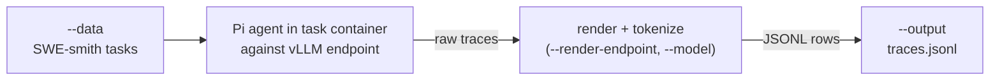

# generate-agentic-traces

Generates agentic execution traces with [Pi](https://github.com/earendil-works/pi) and converts them into speculator-format training rows.

For each task in a SWE-smith-style dataset, a Pi agent runs inside the task container against a vLLM-served target model and records its tool calls and observations as a raw trace. The command then renders and tokenizes each trace into rows with `input_ids` and `loss_mask` for `speculators train`.



## Prerequisites

- The optional Docker dependency: `pip install 'speculators[agentic]'`. The command imports the Docker SDK only when a task runs, so `--help` and argument parsing work without the extra.
- A running vLLM server serving the target model, reachable from the host (used for rendering and tokenization) and from inside the task container (used by the agent). Start the server with `--enable-scale-out`, because the render step calls `/v1/chat/completions/render`, which otherwise returns `403` with `"Scale-out endpoints are disabled. Restart vllm serve with --enable-scale-out to enable them."`.
- A prepared Pi runtime directory (`--pi-runtime`). The next section shows how to install it.
- A container runtime able to start the SWE-smith task images. Missing task images are pulled on first use.

## Prepare the Pi runtime

Install the runtime with the built-in installer:

```bash
speculators generate-agentic-traces setup-pi --path ./pi-runtime
```

The installer downloads the pinned Node.js release for the host platform, runs `npm install @earendil-works/pi-coding-agent` into the target directory, creates `bin/pi`, and copies `rg` from your PATH when it finds it. It then runs `bin/pi --version` to check that the launcher starts. Point `--pi-runtime` at the resulting directory.

Options:

- `--path` / `-p` (default: `./pi-runtime`) Target directory.
- `--node-version` (default: `v24.22.2`) Node.js version to download.
- `--force` Replace an existing installation. Without it the installer leaves an existing directory alone, and it refuses to write into a non-empty directory that is not a Pi runtime.
- `--skip-rg` Do not copy ripgrep into `bin/rg`. Pass this when the task container provides `rg` itself.
- `--yes` / `-y` Skip the confirmation prompt. The prompt defaults to No and lists the Node version, npm package, ripgrep step, and whether an existing directory will be replaced.

The installer supports Linux x86_64 and arm64. It fails on other platforms. If you prefer to build the runtime by hand, reproduce the same steps: download Node, install the Pi package with `npm install --prefix`, symlink `bin/pi` to `../node_modules/.bin/pi`, and copy `rg` into `bin/`.

## Basic usage

```bash
speculators generate-agentic-traces setup-pi --path ./pi-runtime

speculators generate-agentic-traces \
  --model Qwen/Qwen3-32B \
  --data ./swe_smith_tasks.jsonl \
  --render-endpoint http://localhost:8000 \
  --pi-runtime ./pi-runtime \
  --output ./traces.jsonl
```

The generation options live on the `generate-agentic-traces` group, so a direct invocation without a subcommand runs trace generation. `setup-pi` is the only subcommand.

## Arguments

### Data arguments

- **`--model`** (str, required) HuggingFace model ID or local path for the target model. Used to load the tokenizer/processor that converts traces into rows.

- **`--data`** (str, repeatable, required) SWE-smith-style task datasets: a local JSON/JSONL file, a directory of them, a HuggingFace dataset id, or a `hf:` prefixed id.

- **`--limit`** (int, default: `None`) Run at most N tasks.

- **`--max-samples`** (int, default: `None`) Write at most N output rows.

### Agent arguments

- **`--pi-runtime`** (str, required) Path to the prepared Pi runtime. The directory must contain `bin/pi` and the Pi Node dependencies.

- **`--pi-endpoint`** (str, default: `http://host.docker.internal:8000/v1`) OpenAI-compatible endpoint as seen from inside the task container.

- **`--pi-provider`** (str, default: `vllm`) Pi provider name.

- **`--pi-model`** (str, default: `qwen3.8-27b`) Model name exposed to Pi by that endpoint.

- **`--tools`** (str, default: `read,bash,edit,write`) Comma-separated list of tools enabled for the agent.

- **`--workers`** (int, default: `4`) Number of tasks run concurrently.

- **`--timeout`** (int, default: `900`) Per-task timeout in seconds.

### Rendering and output arguments

- **`--render-endpoint`** (str, required) Base URL of the vLLM server used to render traces (e.g. `http://localhost:8000`).

- **`--seq-length`** (int, default: `32768`) Maximum sequence length of an output row.

- **`--output`** (str, required) Output JSONL path, e.g. `traces.jsonl`. Parent directories are created.

- **`--trace-dir`** (str, default: `<output>.traces`) Directory holding the raw traces.

- **`--keep-traces` / `--no-keep-traces`** (default: keep) Keep the raw trace directory after conversion.

## Output format

Rows are in speculator format, one row per training segment of a trace:

```json
{
  "id": "instance-abc_0",
  "primary_id": "instance-abc",
  "input_ids": [151644, 872, ...],
  "loss_mask": [0, 0, ..., 1, 1],
  "text": "<|im_start|>user\n...<|im_end|>\n<|im_start|>assistant\n...",
  "metadata": {}
}
```

- `primary_id` is the task's instance id; `id` is unique per output row.
- `loss_mask` is `0` over prompt/environment observation tokens and `1` over tokens generated by the target model.
- `text` is a human-readable decode of `input_ids`, for review only.

The command logs and skips tasks that fail to run or whose trace it cannot convert, and still writes the remaining rows. If it produces no rows, it exits with a non-zero status.

The output file can be passed directly to `speculators train`, alongside hidden states generated with `speculators generate-offline-data`.
