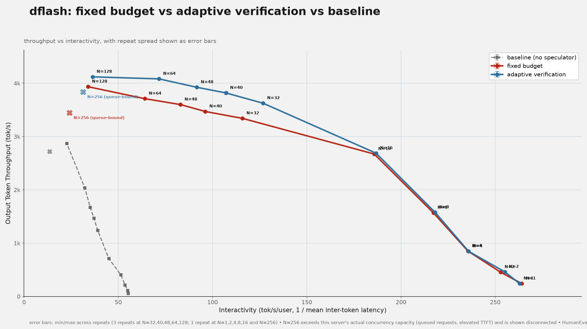
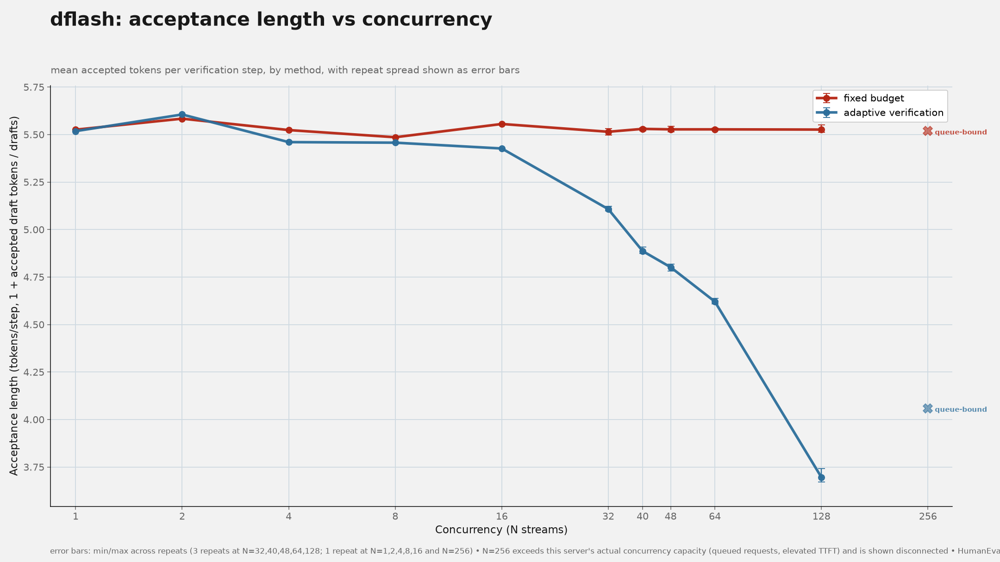
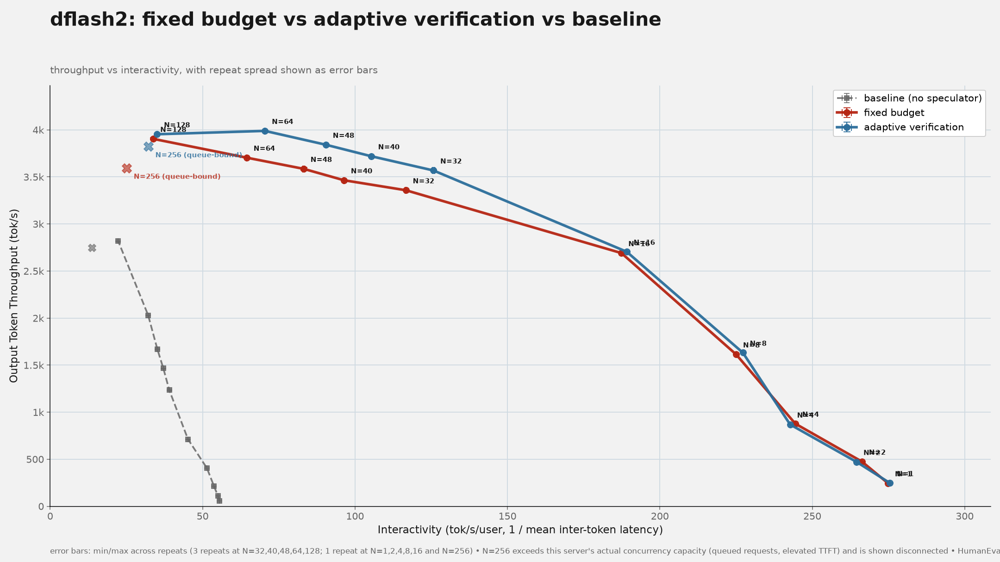
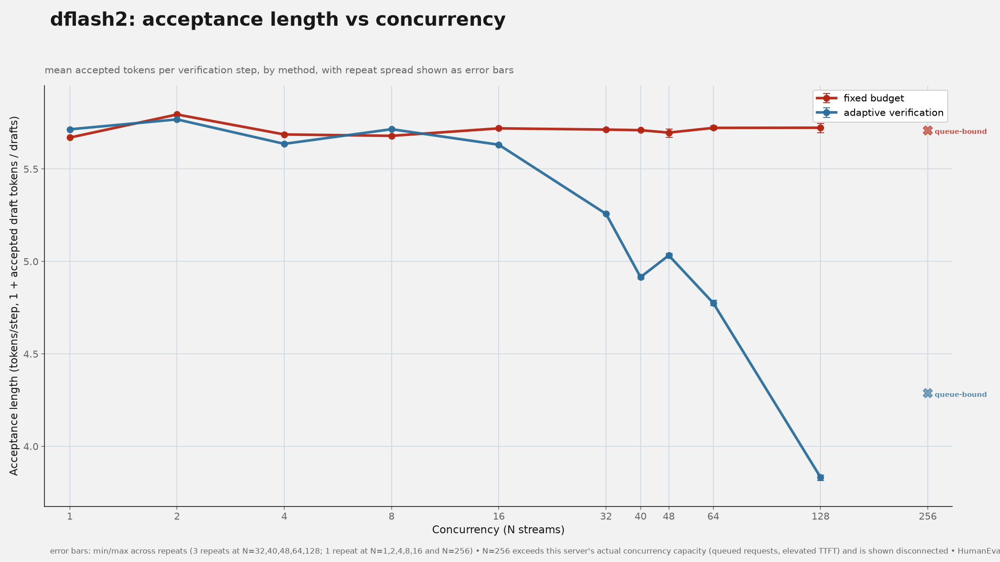
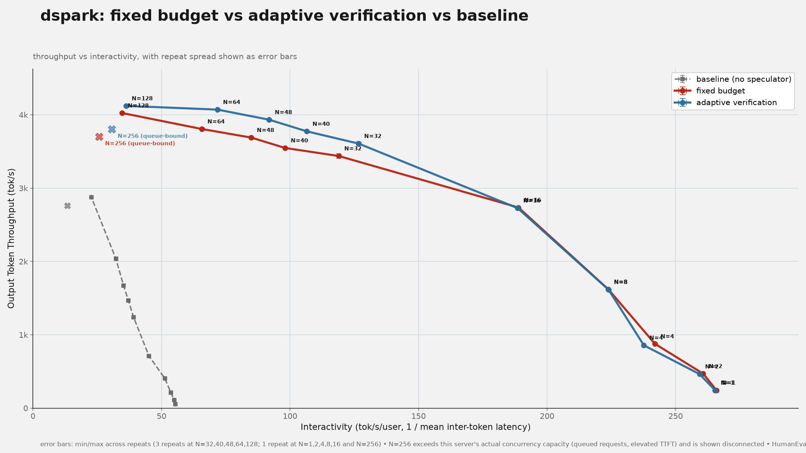

<div class="entry-byline" markdown>
[{ .entry-avatar }](https://github.com/shubhra)
**[@shubhra](https://github.com/shubhra)** posted on **2026-10-29**
</div>

# Adaptive verification vs. fixed draft budget on Gemma4-31B-it: DFlash, DFlash2, DSpark

## Summary

vLLM's adaptive verification (AV) was compared against a fixed draft budget for all three Gemma4-31B-it speculators (DFlash, DFlash2, DSpark). AV matches fixed budget at low concurrency and increasingly outperforms it as concurrency rises: at the peak of the tested range (N=40-64), AV gives up to +10% aggregate throughput and up to +12% interactivity at the same concurrency, narrowing to +1.3% to +4.7% throughput at N=128. Gains are of similar magnitude across all three drafters. AV's acceptance length drops under load while the fixed budget's stays flat, which is the mechanism: AV trades accepted tokens per step for cheaper verification steps as concurrency rises. Getting DSpark's AV running at all required an attention-backend fix not needed for DFlash/DFlash2.

## Setup

- Target model: `google/gemma-4-31B-it`
- Draft models: `RedHatAI/gemma-4-31B-it-speculator.dflash`, `.dflash2`, `.dspark`
- Algorithm: `num_speculative_tokens=7` for all three; each tested with a fixed draft budget and with vLLM's adaptive verification (`enable_adaptive_verification=true`), plus a no-speculator baseline
- Serving: vLLM 0.31.0, one GPU per server (`--tensor-parallel-size 1`), `--no-enable-prefix-caching`, `--attention-backend TRITON_ATTN` forced on every configuration (baseline/fixed/AV) so the backend never varies within a drafter. DSpark additionally requires `--language-model-only` on all three of its configurations, including baseline; see Observations.
- Evaluation: `RedHatAI/speculator_benchmarks`, HumanEval subset, closed-loop sweep (guidellm 0.8.1) via `speculators/scripts/evaluate/throughput_interactivity.py`, `max_tokens=1024`. Concurrency N=1,2,4,8,16 (1 repeat, 30s warmup / 90s window) and N=32,40,48,64,128 (3 repeats, 60s warmup / 120s window); the N=32..128 band is where fixed and AV differ, so it is the one scattered across repeats. N=40,48 were added alongside the original N=32,64 so that `num_speculative_tokens × N` (K·bsz, the draft tokens batched per verification step) lands inside 280-336, squarely in the 250-300 window flagged by prior testing as where AV typically starts beating a fixed budget; the original N=32,64 pair (K·bsz 224/448) straddled that window without a point inside it. Repeat spread at N=128 was under 1% of the mean for every series.
- Software: speculators `0.9.0a68` (commit `b97b64a`)
- Hardware: 1x NVIDIA H200 per server

## Reproduction

Fixed budget:

```bash
vllm serve google/gemma-4-31B-it --max-model-len 16384 --max-num-seqs 256 \
  --max-num-batched-tokens 16384 --no-enable-prefix-caching --tensor-parallel-size 1 \
  --attention-backend TRITON_ATTN \
  --speculative-config '{"model":"RedHatAI/gemma-4-31B-it-speculator.dflash","num_speculative_tokens":7,"method":"dflash"}'
```

Adaptive verification: add `"enable_adaptive_verification":true` to `--speculative-config`. For DSpark, also add `--language-model-only` and set `"method":"dspark"`.

```bash
python scripts/evaluate/throughput_interactivity.py collect --target http://localhost:8114 \
  --model google/gemma-4-31B-it --dataset RedHatAI/speculator_benchmarks --subset HumanEval \
  --max-tokens 1024 --repeats 3 --streams 32,40,48,64,128 --max-seconds 120 --warmup-seconds 60 \
  --out-dir <dir> --label speculator_adapt_veri --csv <dir>/speculator_adapt_veri_HumanEval.csv
```

## Results

Peak concurrency (N=128), mean of 3 repeats:

| Drafter | Fixed tok/s | AV tok/s | Δ throughput | Fixed interactivity | AV interactivity | Δ interactivity |
| ------- | ----------: | -------: | -----------: | ------------------: | ---------------: | --------------: |
| DFlash  |     3,934.6 |  4,119.2 |        +4.7% |                33.9 |             36.4 |           +7.3% |
| DFlash2 |     3,904.1 |  3,953.4 |        +1.3% |                33.8 |             35.1 |           +3.6% |
| DSpark  |     4,024.0 |  4,121.4 |        +2.4% |                34.7 |             36.2 |           +4.5% |

Interactivity is tok/s/user (1 / mean inter-token latency). AV's advantage is largest mid-range: at N=64, DFlash gets +10.0% throughput and +11.8% interactivity; DFlash2 +7.7%/+9.3%; DSpark +7.0%/+9.2%. At N≤16 the two methods are within noise of each other (both configurations run the full fixed draft budget at this load).

Acceptance length (mean accepted tokens per verification step, including the verifier's own token) at the concurrency extremes:

| Drafter | Fixed AL, N=1 | Fixed AL, N=128 | AV AL, N=1 | AV AL, N=128 |
| ------- | ------------: | --------------: | ---------: | -----------: |
| DFlash  |          5.53 |            5.53 |       5.52 |         3.70 |
| DFlash2 |          5.67 |            5.72 |       5.71 |         3.83 |
| DSpark  |          5.67 |            5.69 |       5.67 |         3.74 |

Fixed budget's acceptance length is flat across concurrency; AV's drops by about a third from N=1 to N=128 for all three drafters.

### DFlash

 

### DFlash2

 

### DSpark

 

## Observations

- AV is never worse than fixed budget anywhere in the tested range for any of the three drafters, and the two are indistinguishable at low concurrency (N≤16), where neither the GPU nor the verifier is saturated enough for AV's budget-shrinking to trigger. This is consistent with the K·bsz framing in Setup: AV's measured gains both appear and peak in the N=40-64 band this sweep was tuned to land inside.
- The mechanism behind AV's gain is visible directly in the acceptance-length charts: AV's acceptance length falls as concurrency rises (it verifies fewer draft tokens per step under load), while the fixed budget's stays flat across all N. AV is trading accepted tokens per step for cheaper, faster verification steps once the server is busy enough that this trade pays off.
- Gains are similar in magnitude across all three drafters at matching concurrency, suggesting the effect is primarily a property of AV and this workload's load profile rather than of a particular drafter architecture.
- DSpark's AV did not work out of the box with this setup: forcing `--attention-backend TRITON_ATTN` alone still silently resolved to the `TRITON_FLASH_ATTN` composite backend, which lacks the cudagraph support AV needs on Gemma4's sliding-window layers. Unlike DFlash/DFlash2, DSpark required `--language-model-only` together with the forced backend to actually get `TRITON_ATTN` selected. Because of this, DSpark's baseline and fixed-budget configurations also carry `--language-model-only` (for a same-backend-everywhere comparison within DSpark), a flag DFlash/DFlash2's configurations do not have.
- Worth a closer look: DSpark's throughput gain at N=128 (+2.4%) and DFlash2's (+1.3%) are both smaller than DFlash's (+4.7%), even though DSpark's and DFlash2's acceptance lengths are slightly higher than DFlash's at baseline. Not yet isolated whether this is an effect of DSpark's extra `--language-model-only` flag, of DFlash2's architecture, or just noise at this one concurrency point.
- Only HumanEval was tested; the other 8 subsets in `RedHatAI/speculator_benchmarks` have different acceptance-length profiles and are not covered here.
- Only one target model (Gemma4-31B-it) and one draft budget (K=7) were tested.
- A single exploratory N=256 point (1 repeat, no spread) was added to each chart above, marked "queue-bound" and drawn disconnected from the clean curve. Nothing stalled or errored (0 errored requests, full 120s window, similar completed-request counts to N=128) — but of the 256 requested streams, the scheduler only ever actually ran a subset at once, queueing the rest: baseline averaged ~198-202 running (vs ~127 at N=128), fixed budget ~147-152 (vs ~124), and AV only ~127-132 (vs ~125). AV effectively got none of the extra concurrency it was asked for, which is why its N=256 throughput sits close to its own N=128 point rather than dropping sharply the way fixed budget's does. AV still beats fixed budget at N=256 (+11.4% DFlash, +6.4% DFlash2, +2.7% DSpark), but none of these numbers should be read as clean closed-loop measurements the way N≤128 are.

## References

- vLLM adaptive verification: [vllm-project/vllm#60229](https://github.com/vllm-project/vllm/pull/60229)
- Related: [DFlash adaptive verification on Qwen3.5-35B-A3B: CUDA graph capture sizes flip the result](dflash-adaptive-verification-cuda-graphs-tomasruizt.md)
