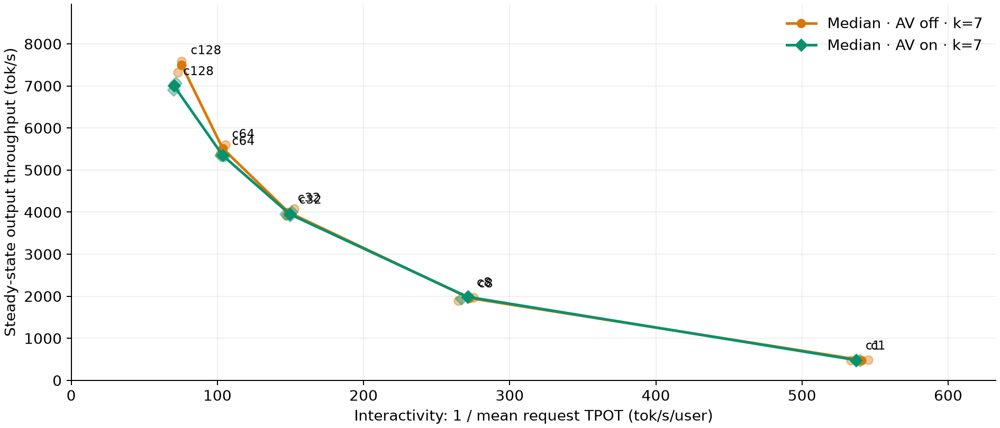
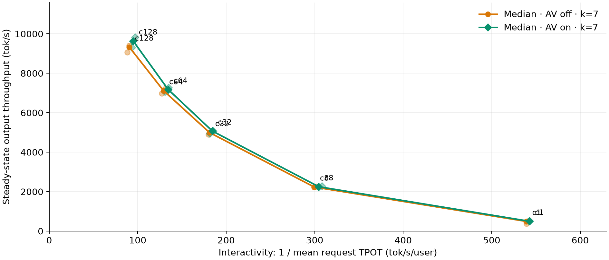

<div class="entry-byline" markdown>
[{ .entry-avatar }](https://github.com/tomasruizt)
**[@tomasruizt](https://github.com/tomasruizt)** posted on **2026-10-19**
</div>

# DFlash adaptive verification on Qwen3.5-35B-A3B: CUDA graph capture sizes flip the result

## Summary

With default CUDA graph capture sizes, adaptive verification (AV, [vllm#60229](https://github.com/vllm-project/vllm/pull/60229)) reduces throughput by 6.6% at c128. The slowdown comes from steps containing a prefill, which exceed the default 1,024-token capture limit and run eagerly. Adding capture sizes up to 6,144 tokens raises AV-off throughput by 24% at c128, and AV then improves throughput at every concurrency (+0.7% to +3.3%). Full report: [Qwen3.5 + Adaptive Verification](https://tomasruizt.github.io/reports/qwen-3.5-dflash-av/).

## Setup

- Target model: `Qwen/Qwen3.5-35B-A3B`, revision `59d61f3ce65a6d9863b86d2e96597125219dc754`, BF16, `--language-model-only`
- Draft model: `z-lab/Qwen3.5-35B-A3B-DFlash`, revision `52cb554b4995dede3e2e1bdb129cdb1f3529332b`
- Algorithm: DFlash, `num_speculative_tokens=7`, `draft_sample_method=probabilistic`, `enable_adaptive_verification` false or true
- Evaluation: SPEED-Bench `throughput_1K`, shuffle seed 42, natural EOS, output capped at 1,024 tokens, thinking disabled, temperature 0
- Serving: vLLM at PR #60229 commit `888ec6bb5745e6060fa2d6a424a37bebbbd84cb9`, TP1, prefix caching off, concurrency 1, 8, 32, 64, 128
- Client: AIPerf 0.13.0, fixed request count per cell (c1: 24, c8: 96, c32: 192, c64: 320, c128: 512), all requests run to completion
- Hardware: 1×B300 per server, two servers on two GPUs

Two workers alternate AV off and on per repeat with a fresh server each time, so both modes run on both GPUs. Each cell has 3 valid runs per mode. Validity gates: no errors, no preemptions, server running p50 ≥ 0.9 × c. All 30 cells passed in each config. Default-graph cells were measured on 2026-10-16, extended-graph cells on 2026-10-19.

Throughput counts output tokens that arrive in the steady-state window: from the c-th completion until the last request is issued. TPOT, ITL and TTFT are means over requests that start inside that window. Acceptance length counts the bonus token.

## Reproduction

Server command (AV on, extended graphs). AV off sets `enable_adaptive_verification` to false, default graphs omit `--compilation-config`:

```bash
vllm serve Qwen/Qwen3.5-35B-A3B --served-model-name qwen --language-model-only \
  --max-model-len 16384 --tensor-parallel-size 1 \
  --max-num-seqs 512 --max-num-batched-tokens 16384 --gpu-memory-utilization 0.92 \
  --no-enable-prefix-caching --disable-uvicorn-access-log \
  --speculative-config '{"method":"dflash","model":"z-lab/Qwen3.5-35B-A3B-DFlash","revision":"52cb554b4995dede3e2e1bdb129cdb1f3529332b","num_speculative_tokens":7,"draft_sample_method":"probabilistic","enable_adaptive_verification":true}' \
  --compilation-config '{"cudagraph_capture_sizes":[1,2,4,8,16,24,32,40,48,56,64,72,80,88,96,104,112,120,128,136,144,152,160,168,176,184,192,200,208,216,224,232,240,248,256,272,288,304,320,336,352,368,384,400,416,432,448,464,480,496,512,528,544,560,576,592,608,624,640,656,672,688,704,720,736,752,768,784,800,816,832,848,864,880,896,912,928,944,960,976,992,1008,1024,1280,1536,1792,2048,2304,2560,2816,3072,3328,3584,3840,4096,5120,6144]}'
```

Client: `aiperf profile --config steady-speedbench.yaml`, one config per cell:

```yaml
schemaVersion: "2.0"
randomSeed: 42
benchmark:
  model: qwen
  endpoint:
    url: http://127.0.0.1:8000
    type: chat
    streaming: true
    use_server_token_count: true
    timeout: 600
    extra:
      temperature: 0
      ignore_eos: false
      min_tokens: 0
      max_completion_tokens: 1024
      chat_template_kwargs:
        enable_thinking: false
  tokenizer:
    name: Qwen/Qwen3.5-35B-A3B
  datasets:
    - name: main
      type: file
      path: throughput_1k.jsonl
      format: speed_bench_throughput_1k
      sampling: shuffle
      random_seed: 42
  phases:
    - name: profiling
      type: concurrency
      requests: 512     # 24, 96, 192, 320, 512
      concurrency: 128  # 1, 8, 32, 64, 128
  server_metrics:
    enabled: true
    urls: [http://127.0.0.1:8000/metrics]
    formats: [json]
```

## Results

Medians of 3 runs. Output tok/s, with acceptance length (AL) in parentheses.

| Concurrency | Default graphs, AV off | Default graphs, AV on |     Δ | Extended graphs, AV off | Extended graphs, AV on |     Δ |
| ----------: | ---------------------: | --------------------: | ----: | ----------------------: | ---------------------: | ----: |
|           1 |             482 (2.71) |            482 (2.61) | +0.1% |              488 (2.71) |             497 (2.61) | +1.7% |
|           8 |           1,958 (2.96) |          1,986 (2.78) | +1.4% |            2,234 (2.99) |           2,248 (2.80) | +0.7% |
|          32 |           3,998 (3.02) |          3,951 (2.69) | −1.2% |            4,994 (2.95) |           5,072 (2.70) | +1.6% |
|          64 |           5,513 (2.89) |          5,346 (2.55) | −3.0% |            7,118 (2.93) |           7,183 (2.53) | +0.9% |
|         128 |           7,504 (2.94) |          7,006 (2.34) | −6.6% |            9,330 (2.94) |           9,641 (2.50) | +3.3% |

Mean ITL at c128 (AV off / on): 39.66 / 33.09 ms with default graphs, 33.30 / 27.26 ms with extended graphs.

Default CUDA graph capture sizes:



Extended CUDA graph capture sizes:



## Observations

- Steps fall into two populations at c128: decode-only (~20 to 25 ms) and steps containing a prefill (~78 to 90 ms). Prefill steps are ~33% of steps but ~68% of time.
- Every prefill step exceeds the default `max_cudagraph_capture_size=1024` on B300, so it runs fully eager. A torch profile of a single 1,080-token prefill shows ~105 ms of CPU time against 19 ms of GPU time. The overhead is Python launch paths in MoE, GDN and the compiled pieces running without graphs, not compute.
- The c128 AV slowdown is an artifact of these eager, CPU-bound prefill steps: once they get piecewise graphs, it disappears. Forcing full verification in prefill steps does not help (c128: 7,006 → 6,945 tok/s). We have not fully split the gap per step type.
- AV consistently lowers AL and ITL. The net effect on throughput depends on how expensive the non-decode steps are.
- The default limit is reached quickly in this workload: a single ~1,080-token prompt already exceeds it, and with k=7 each decode request adds 8 query tokens.
- Follow-up: the same capture-size effect without AV, on Qwen3.8-Flash-Next with MTP3 on 4×B300, is discussed in [vllm#62556](https://github.com/vllm-project/vllm/issues/62556) (+96.8% throughput at c128).
- Not tested: c256 (the hybrid KV cache holds ~150 sequences at this memory utilization), other K values, larger target models where prefill is GPU-bound.
