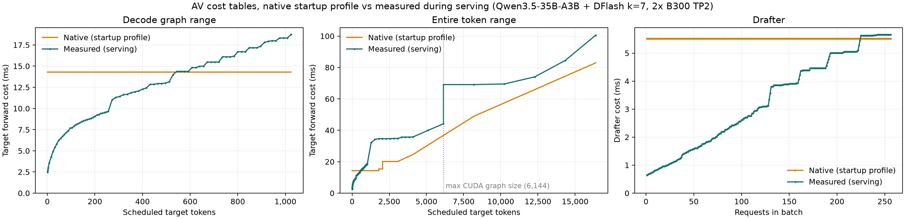
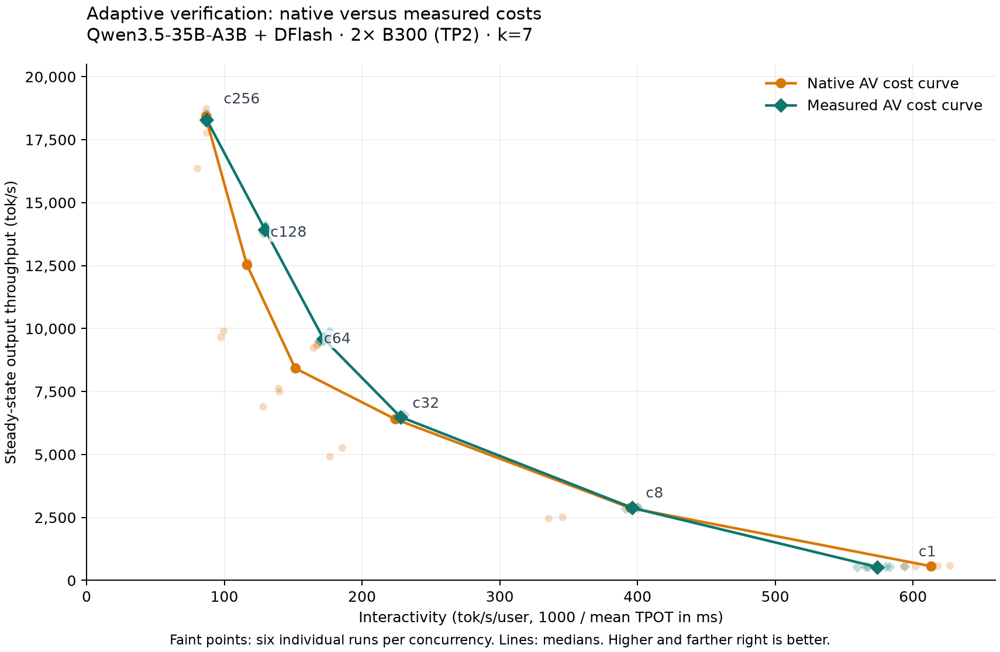

<div class="entry-byline" markdown>
[{ .entry-avatar }](https://github.com/tomasruizt)
**[@tomasruizt](https://github.com/tomasruizt)** posted on **2026-10-20**
</div>

# DFlash adaptive verification: pricing with measured runtimes

## Summary

Adaptive verification (AV) weighs expected accepted tokens against a table of step costs to decide how much of each draft to verify. We replaced the startup-profiled cost table with one built from real serving runtimes and kept everything else fixed. In a six-concurrency sweep the measured table gave the largest gains at c64 (+14.0%) and c128 (+11.1%), was flat at c8, c32 and c256, and lost at c1 (−6.3%). The result is provisional: the two policies were not interleaved and the baseline was noisy.

## What we wanted to know

Each step, AV (here the Qwen3.5 port in [vllm#60229](https://github.com/vllm-project/vllm/pull/60229)) picks the verification budget `b` that maximizes

```text
E[accepted | b] / ( draft_cost[R] + verify_cost[T + b] )
```

`R` is the number of requests and `T` the number of non-draft tokens in the batch. Both sides are estimates. The denominator is a lookup table indexed only by `R` and the token count, filled at startup by profiling dummy batches. That table has known errors: dummy requests skipped part of the recurrent (GDN) work, so larger verification batches could look cheaper than smaller ones (fixed in [tomasruizt/vllm#21](https://github.com/tomasruizt/vllm/pull/21), related upstream fixes in [vllm#54065](https://github.com/vllm-project/vllm/pull/54065) and [vllm#54077](https://github.com/vllm-project/vllm/pull/54077)), and it is profiled at a fixed context length. So the question was simple: **if AV used the step runtimes it actually sees while serving, would it pick better budgets and run faster?**

Only the prices change (the denominator in the equation). The acceptance estimator, the ranking, k=7, the vLLM source and the serving configuration are identical in both arms. Both arms also use extended CUDA graph capture sizes up to 6,144 tokens. With the default 1,024-token limit, mixed prefill steps run eagerly and are CPU-bound, which made AV slower than no AV at c64 and c128 ([earlier report](https://tomasruizt.github.io/reports/qwen-3.5-dflash-av/), discussion in [vllm#62556](https://github.com/vllm-project/vllm/issues/62556)).

## Setup

- Target model: `Qwen/Qwen3.5-35B-A3B`, revision `59d61f3ce65a6d9863b86d2e96597125219dc754`, BF16, `--language-model-only`
- Draft model: `z-lab/Qwen3.5-35B-A3B-DFlash`, revision `52cb554b4995dede3e2e1bdb129cdb1f3529332b`
- Algorithm: DFlash, `num_speculative_tokens=7`, `draft_sample_method=probabilistic`, adaptive verification on in both arms
- Evaluation: SPEED-Bench `throughput_1K`, shuffle seed 42, natural EOS, output capped at 1,024 tokens, thinking disabled, temperature 0
- Serving: vLLM at `888ec6bb` (a commit of PR #60229 from 2026-10-06) plus runtime hooks, TP2, `max_num_seqs=256`, prefix caching off, concurrency 1, 8, 32, 64, 128, 256
- Client: AIPerf 0.13.0, 30 s submission window (38 s at c256), 120 s grace period
- Hardware: 2×B300 (TP2)

## How we measured runtimes

We timed the target and drafter passes with CUDA events on every real serving step (SPEED-Bench, c1 to c256, mixed batches included), with AV's budget randomized so every token count got sampled, plus targeted prefills up to 16,377 tokens. The 37,475 samples were reduced to medians per graph bucket and frozen. The result is a GPU-only cost averaged over context and batch mix, not a perfect oracle.



The native table is flat for small steps (14.3 ms verify up to ~1,800 tokens, 5.5 ms drafter at every batch size), so extra verification looks almost free to AV. It comes from a fresh startup with identical flags, since the sweep's own table was not recorded, and native tables vary between startups.

The code is a runtime hook into vLLM: [install_full_curve.py](https://github.com/tomasruizt/vllm-scripts/blob/55ef343/experiments/qwen_dflash_av_60229/install_full_curve.py) patches the timing and cost-lookup calls into a copy of vLLM, and [av_full_curve.py](https://github.com/tomasruizt/vllm-scripts/blob/55ef343/experiments/qwen_dflash_av_60229/av_full_curve.py) switches a live server between calibrating, native and measured prices. Frozen measured curve: [dflash-av-qwen35-measured-curve.json](../assets/research/dflash-av-qwen35-measured-curve.json) (SHA-256 `43a774f8e1674dde929b6a6e45f03ad1fc75adb016f56f87774f5252954a9368`).

## How we compared the two tables

- One persistent TP2 server on 2×B300. A control file switches AV between the native startup table and the measured frozen table without restarting. Timing events are off during benchmarks.
- Six runs per table and concurrency (72 cells, all passing validity gates: no errors, no preemptions). Throughput and TPOT come from the steady-state window of each run, at least 19 seconds long.
- All 118,287 audited decisions in the measured arm used measured prices, zero fallback.

## Reproduction

vLLM serve (both arms):

```bash
CG_SIZES=$(printf '%s\n' 1 2 4 $(seq 8 8 248) $(seq 256 16 1024) $(seq 1280 256 4096) 5120 6144 | paste -sd,)
VLLM_USE_V2_MODEL_RUNNER=1 VLLM_ADAPTIVE_VERIFICATION_PROFILE_CONTEXT_LEN=1024 OMP_NUM_THREADS=1 \
vllm serve Qwen/Qwen3.5-35B-A3B --served-model-name qwen --language-model-only \
  --max-model-len 16384 --tensor-parallel-size 2 --max-num-seqs 256 --max-num-batched-tokens 16384 \
  --gpu-memory-utilization 0.92 --no-enable-prefix-caching --disable-uvicorn-access-log \
  --speculative-config '{"method":"dflash","model":"z-lab/Qwen3.5-35B-A3B-DFlash","revision":"52cb554b4995dede3e2e1bdb129cdb1f3529332b","num_speculative_tokens":7,"draft_sample_method":"probabilistic","enable_adaptive_verification":true}' \
  --compilation-config "{\"cudagraph_capture_sizes\":[$CG_SIZES]}"
```

AIPerf sweep config (per arm), `aiperf profile --config config.yaml`, 5 trials per arm plus 1 gated pilot:

```yaml
schemaVersion: "2.0"
randomSeed: 42
benchmark:
  model: qwen
  endpoint: {type: chat, streaming: true, use_server_token_count: true, timeout: 600,
    extra: {temperature: 0, ignore_eos: false, max_completion_tokens: 1024,
            chat_template_kwargs: {enable_thinking: false}}}
  datasets:
    - {name: main, type: file, path: throughput_1k.jsonl,
       format: speed_bench_throughput_1k, sampling: shuffle, random_seed: 42}
  phases:
    - {name: profiling, type: concurrency, duration: 30, grace_period: 120}
sweep:
  type: zip
  same_seed: true
  parameters:
    concurrency: [1, 8, 32, 64, 128, 256]
    duration:    [30, 30, 30, 30, 30, 38]
```

## Results



Each faint point is one run, lines connect medians. Higher and further right is better. Note the spread of the faint orange native points at c64 and c128.

Medians of 6 runs. Change is the ratio of medians, not a paired estimate. Acceptance length (AL) counts the bonus token.

|   c | Native tok/s | Measured tok/s |  Change | Native TPOT (ms) | Measured TPOT (ms) | Native AL | Measured AL |
| --: | -----------: | -------------: | ------: | ---------------: | -----------------: | --------: | ----------: |
|   1 |          567 |            531 |  −6.27% |             1.63 |               1.74 |      2.64 |        2.53 |
|   8 |        2,879 |          2,883 |  +0.14% |             2.53 |               2.52 |      2.83 |        2.75 |
|  32 |        6,404 |          6,494 |  +1.41% |             4.46 |               4.39 |      2.71 |        2.78 |
|  64 |        8,425 |          9,602 | +13.98% |             6.60 |               5.82 |      2.70 |        2.83 |
| 128 |       12,544 |         13,939 | +11.12% |             8.60 |               7.72 |      2.88 |        2.84 |
| 256 |       18,418 |         18,298 |  −0.65% |            11.57 |              11.47 |      2.83 |        2.77 |

Acceptance length moves only a few percent in either direction, which is expected: the policy optimizes accepted tokens per millisecond, not acceptance. At c128 the measured table runs faster with slightly lower AL, consistent with cheaper verification choices. We did not record per-step budgets in this sweep, so that mechanism is not confirmed. At c1 both AL and throughput drop, so the measured table is worse there.

## Why the result is provisional

- **Run order.** AIPerf ran all five measured sweeps first and then all five native sweeps. Any drift over time is confounded with the policy.
- **Noisy baseline.** Native throughput spans 6,898 to 9,380 tok/s at c64 and 9,660 to 12,674 tok/s at c128, while native AL stays within 2.87 to 2.90 at c128. Something other than acceptance moves native throughput by 30% or more, and that spread is as large as the headline gains.
- **Earlier result not reproduced.** A first c256 comparison against a historical baseline showed +3.7%. The matched sweep gives −0.65% at c256.
- **Averaged costs.** The curve averages over context length and prefill and decode mix, and ignores CPU time.

## Next steps

- Rerun c1, c64 and c128 with the two tables interleaved run by run, and explain the native variance before claiming a gain.
- Explain why the native startup table is flat for small steps, measure how much it varies between startups, and record it in every run.
- Quantify how much cost varies with batch composition and context at fixed token count, to see whether a composition-aware curve is needed.
- Compare AV against a simpler batch-size-keyed fixed-K schedule (dynamic speculative decoding), which may capture most of the benefit with no cost model.
