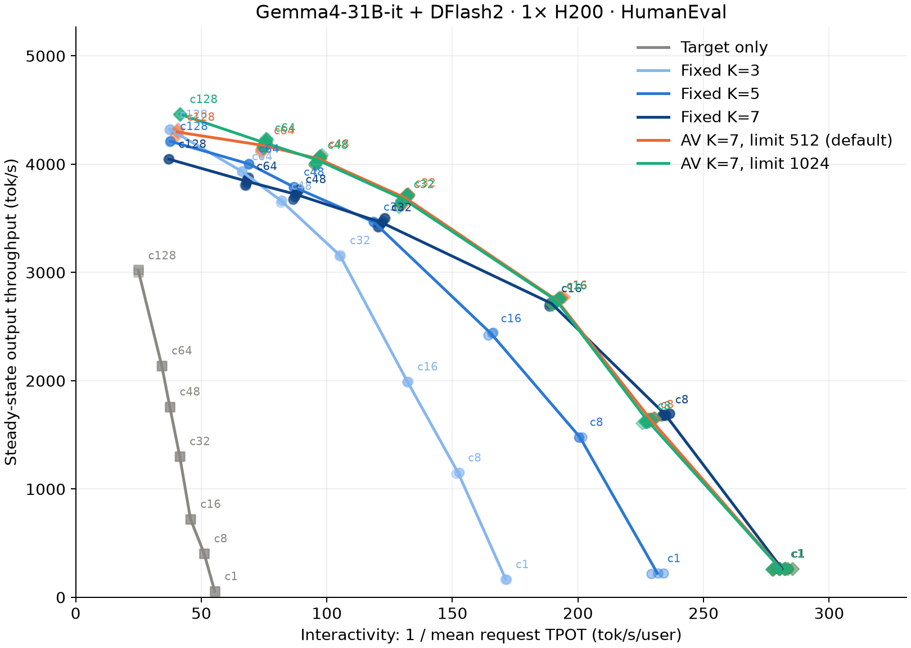

<div class="entry-byline" markdown>
[{ .entry-avatar }](https://github.com/tomasruizt)
**[@tomasruizt](https://github.com/tomasruizt)** posted on **2026-11-09**
</div>

# DFlash2 adaptive verification on Gemma4-31B-it: raising the capture limit lets AV beat every fixed K at c128

## Summary

Adaptive verification (AV, [vllm#60229](https://github.com/vllm-project/vllm/pull/60229)) beats the best fixed draft budget from c32 to c64 (+4.3% to +6.9%), but at c128 it only ties fixed K=3 with the default CUDA graph capture limit of 512 rows. Raising the limit to 1,024 rows lets AV beat every fixed K at c128 (+3.2% over K=3, +10% over K=7), because AV's startup cost table overprices steps above the limit. This follows up on [the earlier Gemma4 note](adaptive-verification-dflash-dflash2-dspark-gemma4-shubhra.md).



## Setup

- Target: `google/gemma-4-31B-it` (`842da37`), BF16. Draft: `RedHatAI/gemma-4-31B-it-speculator.dflash2` (`b0cd01b`)
- Algorithm: DFlash2 (`"method":"dflash"`), fixed K=3, 5, 7, or AV with K=7
- Evaluation: `RedHatAI/speculator_benchmarks` HumanEval (164 prompts), output capped at 1,024 tokens, temperature 1.0, top_k 64, top_p 0.95
- Serving: vLLM main `1b2505c033` (2026-11-06), TP1, `--max-num-seqs 128`, prefix caching off, `TRITON_ATTN`, each server swept over c1 to c128. Fixed K=7 and both AV settings were also rerun on 3 more GPUs (c1 to c64), and the plot pools these runs, so GPU placement does not bias them.
- Client: AIPerf 0.13.0, 3 runs of 60 s per concurrency. Throughput counts output tokens in the steady window (c-th completion to last request issued). tok/s/user is 1000 / mean TPOT. AL is 1 + accepted / drafts, so it counts the bonus token.
- Hardware: 1x H200 (143,771 MiB) per server, PyTorch 2.14.0+cu130. All cells had no errors, no preemptions and no queueing.

## Reproduction

```bash
vllm serve google/gemma-4-31B-it --max-model-len 16384 --max-num-seqs 128 \
  --max-num-batched-tokens 16384 --no-enable-prefix-caching --attention-backend TRITON_ATTN \
  --speculative-config '{"model":"RedHatAI/gemma-4-31B-it-speculator.dflash2","num_speculative_tokens":7,"method":"dflash","enable_adaptive_verification":true}' \
  --compilation-config '{"max_cudagraph_capture_size":1536}'
```

The effective limit is 1,024 here (it is capped at `max_num_seqs` x (K+1) in every case we read back). Default limit: omit `--compilation-config`. Fixed budget: `"enable_adaptive_verification":false` and set `num_speculative_tokens`. Target only: omit `--speculative-config`.

Dataset, one `{"text": prompt}` per line:

```bash
SRC=$(hf download RedHatAI/speculator_benchmarks HumanEval.jsonl --repo-type dataset)
python -c "import json, sys; [print(json.dumps({'text': json.loads(l)['prompt']})) for l in open(sys.argv[1])]" "$SRC" > humaneval.jsonl
```

Client: `aiperf profile --config aiperf.yaml`, 3 runs per concurrency (1, 8, 16, 32, 48, 64, 128) against the same server.

<details markdown>
<summary>AIPerf config (shown for c64)</summary>

```yaml
schemaVersion: "2.0"
randomSeed: 42
benchmark:
  model: google/gemma-4-31B-it
  endpoint:
    url: http://127.0.0.1:8000
    type: chat
    streaming: true
    use_server_token_count: true
    timeout: 7200
    extra:
      temperature: 1.0
      max_completion_tokens: 1024
      top_k: 64
      top_p: 0.95
  tokenizer:
    name: google/gemma-4-31B-it
  datasets:
    - name: main
      type: file
      sampling: shuffle
      random_seed: 42
      path: humaneval.jsonl
      format: single_turn
  phases:
    - name: profiling
      type: concurrency
      concurrency: 64
      duration: 60
      grace_period: 30
  server_metrics:
    enabled: true
    urls: [http://127.0.0.1:8000/metrics]
    formats: [json]
```

</details>

## Results

At c128:

| Configuration               | Output tok/s | Speedup vs. target only | tok/s/user |   AL |
| --------------------------- | -----------: | ----------------------: | ---------: | ---: |
| Target only                 |        3,022 |                   1.00x |       25.0 |  N/A |
| Fixed K=7                   |        4,047 |                   1.34x |       36.9 | 5.75 |
| Fixed K=5                   |        4,210 |                   1.39x |       37.6 | 4.79 |
| Fixed K=3                   |        4,322 |                   1.43x |       37.5 | 3.54 |
| AV K=7, limit 512 (default) |        4,300 |                   1.42x |       40.3 | 3.78 |
| AV K=7, limit 1,024         |        4,460 |                   1.48x |       41.5 | 4.78 |

## Observations

- AV's cost table prices a 1,024-row step at 3.1x a 512-row step, while nsys measures 1.6x. So at c128 AV stays at exactly 512 rows in 65% of steps. With limit 1,024, no traced step ran at 512 rows (most ran at 768 to 1,024).
- Steps above the limit are not really slower on Gemma4 (about 0.1 ms per row on both sides), unlike [Qwen3.5](dflash-adaptive-verification-cuda-graphs-tomasruizt.md) and [vllm#62556](https://github.com/vllm-project/vllm/issues/62556). Fixed K=7 gains nothing from the higher limit (-2.2%). The problem is the price, not the execution.
- Below c128 the two AV limits are equivalent. A first sweep with one GPU per curve put limit 1,024 up to 2.2% behind, but that was GPU placement: running each setting on each of 3 GPUs shows the GPUs differing by up to 1.5% under the power cap, and with GPUs balanced limit 1,024 is -0.5% to +1.0% vs. default AV (better on all 3 GPUs at c64). Fixed K=3 and K=5 ran on one GPU each, so treat differences under about 1.5% against them as noise.
- At c8, AV is 2.8% slower than fixed K=7 on all 3 GPUs, at the same AL. nsys shows the same idle time per step but a different target CUDA graph: AV's TRITON_ATTN decode attention runs the 2D kernel (3.2 ms per step) instead of the split-KV 3D kernel with segment reduction (2.5 ms). AV's variable-length decode graphs are captured with one request per token, which pushes the 2D/3D choice past its threshold even when only 8 requests are running. There is no gap at c1, and from c16 on AV's shorter verification outweighs it. Reported in [vllm#66557](https://github.com/vllm-project/vllm/issues/66557).
- Limit 2,048 (needs `--max-num-seqs 256`) shows no clear gain over 1,024. Graph memory grows from 1.14 GiB (512) to 2.34 GiB (1,024) and 3.65 GiB (2,048).
- Fixed K=5 crashed with a CUDA OOM in the DFlash drafter's context-KV precompute at the start of c128, after 30 minutes on the same server. The c128 point comes from a fresh server.
- AL matches the earlier note (fixed K=7 5.75 vs. 5.72, AV 3.78 vs. 3.83). Our throughput is 3% to 9% higher, with a different vLLM version (main vs. 0.31.0) and client (AIPerf vs. guidellm).
- Not tested: DFlash, DSpark, other dataset subsets, vLLM 0.31.0, and a fix in AV's cost table itself (e.g. profiling at the workload's context length instead of 8,192 tokens, which alone gave +3.8% at c128 with limit 512).

## References

- [vllm-project/vllm#60229](https://github.com/vllm-project/vllm/pull/60229) (adaptive verification), [vllm-project/vllm#62556](https://github.com/vllm-project/vllm/issues/62556) (capture sizes at high concurrency)
- [Adaptive verification vs. fixed draft budget on Gemma4-31B-it: DFlash, DFlash2, DSpark](adaptive-verification-dflash-dflash2-dspark-gemma4-shubhra.md)
- [DFlash adaptive verification on Qwen3.5-35B-A3B: CUDA graph capture sizes flip the result](dflash-adaptive-verification-cuda-graphs-tomasruizt.md)
