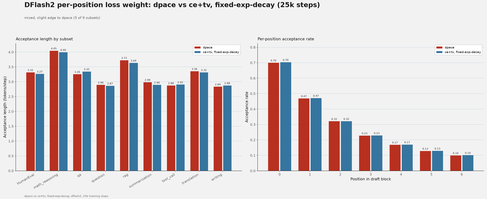
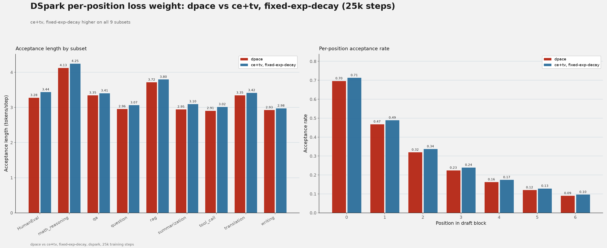
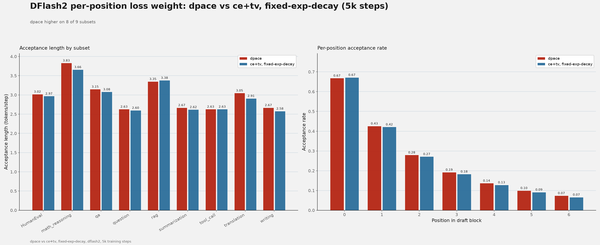
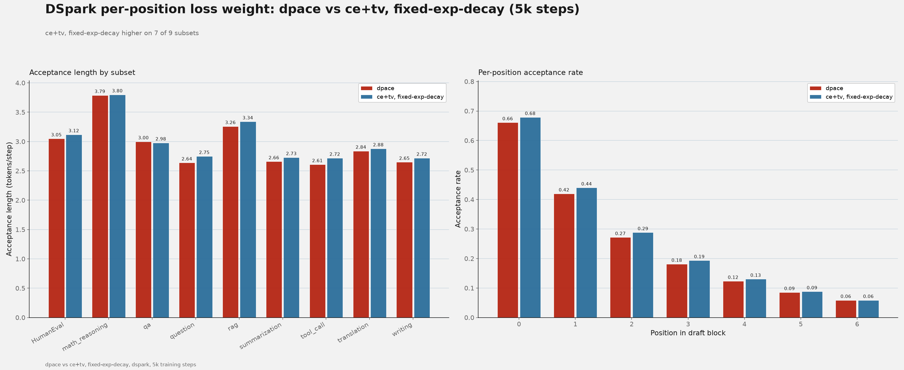
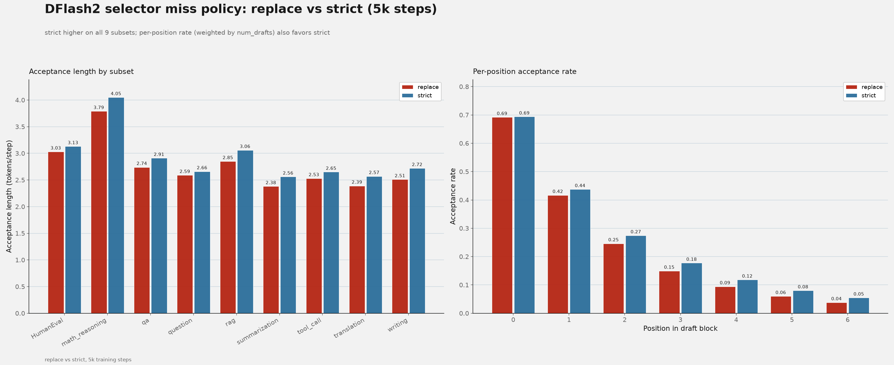
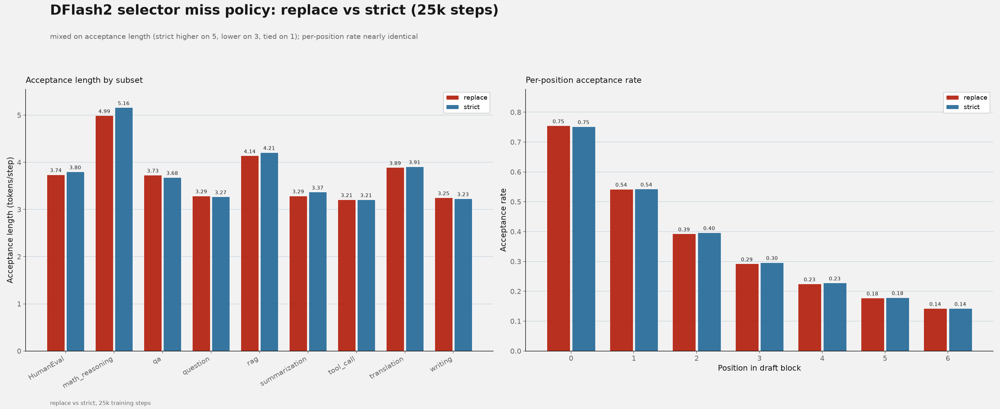
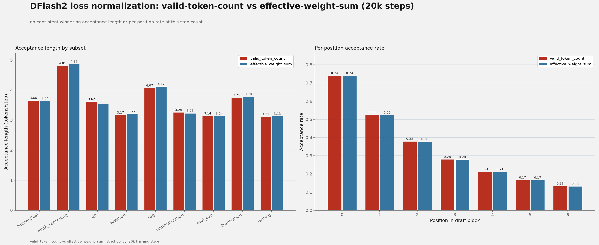

[{ .entry-avatar }](https://github.com/shubhra)
**[@shubhra](https://github.com/shubhra)** posted on **2026-10-28**

# DFlash2 selector and loss-normalization ablations on Qwen3.8-27B

## Summary

DFlash2's draft-model training had several open design questions worth investigating: whether the per-position loss weight `dpace` improves over the alternative, how the selector should handle a missing gold token among its top-K candidates, and how the per-position selector loss should be normalized. This report covers ablations on all three questions on Qwen3.8-27B.

For the per-position loss weight, `dpace` improves acceptance length for DFlash2 at 5k training steps but not consistently at 25k steps, and does not improve DSpark at either step count; `dpace` was kept for DFlash2 and not adopted for DSpark. For the selector miss policy, `strict` improves acceptance length over `replace` on every subset at 5k training steps, which motivated adding `strict` as a selectable policy in [Speculators PR #1217](https://github.com/vllm-project/speculators/pull/1217). At 25k steps the difference narrows and becomes mixed. For loss normalization, `valid_token_count` and `effective_weight_sum` produce comparable acceptance lengths at 20k training steps, with no consistent winner across subsets.

## Setup

- Target model: `Qwen/Qwen3.8-27B`.
- Draft model: DFlash2. DFlash2 drafts tokens with a selector head, which picks candidates from a top-K shortlist, and a unary head; `--selector-miss-policy` (introduced in [Speculators PR #1217](https://github.com/vllm-project/speculators/pull/1217)) controls what happens when the verifier's actual next token isn't in that shortlist during training.
- Per-position loss weight ablation: `dpace` vs. not `dpace`, for both DFlash2 and DSpark, each trained to 5k and 25k steps. DSpark is a sibling drafter architecture to DFlash2 in the same family of speculators models.
- Selector-policy ablation: `replace` vs. `strict`, each trained to 5k and 25k steps, from the same base training recipe.
- Normalization ablation: `valid_token_count` vs. `effective_weight_sum`, each trained to 20k steps with the `strict` policy, from the same base recipe as the selector-policy ablation above.
- Algorithm settings: block size 8, selector top-K 16.
- Training data: a prepared version of the open-perfectblend dataset mix.
- Training: `torchrun`, 4 GPUs per run, seed 42, 1 epoch (step-capped as noted above for the selector-policy and normalization ablations).
- Evaluation: `RedHatAI/speculator_benchmarks` via `evaluate.py ... throughput`. Acceptance length is the mean number of tokens emitted per verification round, including the verifier's own always-emitted token (`1 + accepted draft tokens / drafts`).
- Hardware: 8x NVIDIA H200 node (4 GPUs used per training run).

## Reproduction

The strict selector miss policy is implemented in [Speculators PR #1217](https://github.com/vllm-project/speculators/pull/1217).

## Results

### Per-position loss weight: dpace versus ce+tv, fixed-exp-decay

`dpace` is a confidence-based per-position loss weight: it converts the per-position cross-entropy loss to a confidence score, smooths it with a constant `dpace_alpha` (default 0.5), and combines positions within a block via a cumulative-product/suffix-sum to produce the final per-position weight. The comparison arm uses a `{"ce":0.1,"tv":0.9}` loss function with `fixed-exp-decay` per-position weighting (a fixed exponential decay by position, independent of model confidence; `fixed-exp-decay` is DFlash2's and DSpark's default per-position weight). This ablation was run for both DFlash2 and DSpark, at 5k and 25k training steps each. Absolute acceptance length is lower at 5k than at 25k across all four configurations below, consistent with less training; compare `dpace` against `ce+tv, fixed-exp-decay` within each step count instead of across them.

#### 25k training steps, DFlash2

| Subset         | dpace | ce+tv, fixed-exp-decay | dpace − ce+tv, fixed-exp-decay |
| -------------- | ----: | ---------------------: | -----------------------------: |
| HumanEval      |  3.32 |                   3.27 |                          +0.05 |
| math_reasoning |  4.05 |                   4.00 |                          +0.05 |
| qa             |  3.26 |                   3.35 |                          −0.08 |
| question       |  2.90 |                   2.87 |                          +0.03 |
| rag            |  3.73 |                   3.64 |                          +0.08 |
| summarization  |  2.99 |                   2.90 |                          +0.09 |
| tool_call      |  2.88 |                   2.91 |                          −0.03 |
| translation    |  3.36 |                   3.32 |                          +0.04 |
| writing        |  2.84 |                   2.88 |                          −0.05 |

Mixed: `dpace` is higher on six subsets, lower on three. Mean acceptance length is approximately 3.26 for `dpace` and 3.24 for `ce+tv, fixed-exp-decay`.

#### 25k training steps, DSpark

| Subset         | dpace | ce+tv, fixed-exp-decay | dpace − ce+tv, fixed-exp-decay |
| -------------- | ----: | ---------------------: | -----------------------------: |
| HumanEval      |  3.28 |                   3.44 |                          −0.17 |
| math_reasoning |  4.13 |                   4.25 |                          −0.13 |
| qa             |  3.35 |                   3.41 |                          −0.06 |
| question       |  2.96 |                   3.07 |                          −0.11 |
| rag            |  3.72 |                   3.80 |                          −0.08 |
| summarization  |  2.95 |                   3.10 |                          −0.14 |
| tool_call      |  2.91 |                   3.02 |                          −0.11 |
| translation    |  3.35 |                   3.42 |                          −0.06 |
| writing        |  2.93 |                   2.98 |                          −0.05 |

`ce+tv, fixed-exp-decay` is higher on all nine subsets for DSpark at 25k steps. Mean acceptance length is approximately 3.29 for `dpace` and 3.39 for `ce+tv, fixed-exp-decay`.

#### 5k training steps, DFlash2

| Subset         | dpace | ce+tv, fixed-exp-decay | dpace − ce+tv, fixed-exp-decay |
| -------------- | ----: | ---------------------: | -----------------------------: |
| HumanEval      |  3.02 |                   2.97 |                          +0.05 |
| math_reasoning |  3.83 |                   3.66 |                          +0.17 |
| qa             |  3.15 |                   3.08 |                          +0.07 |
| question       |  2.63 |                   2.60 |                          +0.04 |
| rag            |  3.35 |                   3.38 |                          −0.03 |
| summarization  |  2.67 |                   2.62 |                          +0.04 |
| tool_call      |  2.63 |                   2.63 |                           0.00 |
| translation    |  3.05 |                   2.91 |                          +0.14 |
| writing        |  2.67 |                   2.58 |                          +0.09 |

`dpace` is higher on eight of nine subsets for DFlash2 at 5k steps. Mean acceptance length is approximately 3.00 for `dpace` and 2.94 for `ce+tv, fixed-exp-decay`.

#### 5k training steps, DSpark

| Subset         | dpace | ce+tv, fixed-exp-decay | dpace − ce+tv, fixed-exp-decay |
| -------------- | ----: | ---------------------: | -----------------------------: |
| HumanEval      |  3.05 |                   3.12 |                          −0.07 |
| math_reasoning |  3.79 |                   3.80 |                          −0.00 |
| qa             |  3.00 |                   2.98 |                          +0.02 |
| question       |  2.64 |                   2.75 |                          −0.11 |
| rag            |  3.26 |                   3.34 |                          −0.09 |
| summarization  |  2.66 |                   2.73 |                          −0.08 |
| tool_call      |  2.61 |                   2.72 |                          −0.12 |
| translation    |  2.84 |                   2.88 |                          −0.04 |
| writing        |  2.65 |                   2.72 |                          −0.06 |

`ce+tv, fixed-exp-decay` is higher on seven of nine subsets for DSpark at 5k steps. Mean acceptance length is approximately 2.94 for `dpace` and 3.00 for `ce+tv, fixed-exp-decay`.

Across both step counts, `dpace` is at best mixed for DFlash2 and consistently worse than `ce+tv, fixed-exp-decay` for DSpark. `fixed-exp-decay` remains the default per-position loss weight for both architectures; these ablations did not surface a clear case for switching DFlash2 to `dpace`.

### Strict versus replace selector policy

When the verifier's target token is absent from the selector's top-K candidates, `replace` inserts the target into the last candidate slot and trains the selector on that position. `strict` leaves the candidate set unchanged and masks the selector loss for that position; the unary loss remains active.

#### 5k training steps

Acceptance length by subset (tokens per round):

| Subset         | Replace | Strict | Strict − replace |
| -------------- | ------: | -----: | ---------------: |
| HumanEval      |    3.03 |   3.13 |            +0.10 |
| math_reasoning |    3.79 |   4.05 |            +0.26 |
| qa             |    2.74 |   2.91 |            +0.17 |
| question       |    2.59 |   2.66 |            +0.07 |
| rag            |    2.85 |   3.06 |            +0.21 |
| summarization  |    2.38 |   2.56 |            +0.18 |
| tool_call      |    2.53 |   2.65 |            +0.12 |
| translation    |    2.39 |   2.57 |            +0.18 |
| writing        |    2.51 |   2.72 |            +0.21 |

Strict is higher on all nine subsets at 5k steps, which prompted adding `strict` as a selectable policy in [Speculators PR #1217](https://github.com/vllm-project/speculators/pull/1217). Mean acceptance length is approximately 2.76 for replace and 2.92 for strict.

#### 25k training steps

| Subset         | Replace | Strict | Strict − replace |
| -------------- | ------: | -----: | ---------------: |
| HumanEval      |    3.74 |   3.80 |            +0.06 |
| math_reasoning |    4.99 |   5.16 |            +0.17 |
| qa             |    3.73 |   3.68 |            −0.05 |
| question       |    3.29 |   3.27 |            −0.02 |
| rag            |    4.14 |   4.21 |            +0.07 |
| summarization  |    3.29 |   3.37 |            +0.08 |
| tool_call      |    3.21 |   3.21 |             0.00 |
| translation    |    3.89 |   3.91 |            +0.02 |
| writing        |    3.25 |   3.23 |            −0.02 |

At 25k steps the results are mixed: strict is higher on five subsets, lower on three, and tied on one. Mean acceptance length is approximately 3.73 for replace and 3.76 for strict. Per-position acceptance rates are nearly identical between the two policies.

The training-time validation metric `val/unary_candidate_recall_at_16_epoch` (how often the gold token appears in the unary head's top-16 candidates) favors `strict` at both step counts: 0.687 → 0.713 at 5k, and 0.780 → 0.790 at 25k. This metric is more consistent than the downstream acceptance-length comparison above.

### Valid-token-count versus effective-weight-sum normalization

The two loss reductions differ in their denominator:

- `valid_token_count`: divides the weighted loss by the number of valid tokens, using `loss_mask.sum()`.
- `effective_weight_sum`: rescales the loss by `valid.sum() / (valid * decay_weight).sum()`, so the effective denominator is the sum of valid per-position decay weights.

Acceptance length by subset (tokens per round):

#### 20k training steps

| Subset         | Valid-token count | Effective-weight sum |
| -------------- | ----------------: | -------------------: |
| HumanEval      |              3.66 |                 3.64 |
| math_reasoning |              4.81 |                 4.87 |
| qa             |              3.62 |                 3.55 |
| question       |              3.17 |                 3.22 |
| rag            |              4.07 |                 4.12 |
| summarization  |              3.26 |                 3.23 |
| tool_call      |              3.14 |                 3.14 |
| translation    |              3.75 |                 3.78 |
| writing        |              3.11 |                 3.13 |
| Mean           |              3.62 |                 3.63 |

Mean acceptance length is very similar between the two normalization schemes, and per-position acceptance rates nearly overlap. Subset-level differences are small and mixed in direction, showing no consistent winner between the two normalization methods at this step count.

## Observations

- `dpace` gives a mixed-to-favorable result for DFlash2 (higher at 5k steps, mixed at 25k) but a consistently unfavorable one for DSpark at both step counts; `dpace` was kept for DFlash2 and not adopted for DSpark.
- The `strict` selector miss policy improved acceptance length over `replace` on every subset at 5k training steps, motivating its addition as a selectable training option; at 25k training steps the difference narrows and becomes mixed.
- `val/unary_candidate_recall_at_16_epoch` consistently favors `strict` over `replace` at both 5k and 25k training steps, even where downstream acceptance length does not.
- `valid_token_count` and `effective_weight_sum` loss normalization produce comparable acceptance lengths at 20k training steps, with no consistent subset-level winner.
- Results above do not include run-to-run variance or confidence intervals; subset-level differences should be interpreted descriptively rather than as statistically significant.

## Next steps

These ablations led to landing the `strict` selector miss policy in [Speculators PR #1217](https://github.com/vllm-project/speculators/pull/1217). We are now training a new DFlash2 drafter that incorporates `strict` along with further changes, aimed at producing a more usable drafter overall. Results from that effort will be reported separately.

## References

- [DFlash2 strict selector miss policy, Speculators PR #1217](https://github.com/vllm-project/speculators/pull/1217)
