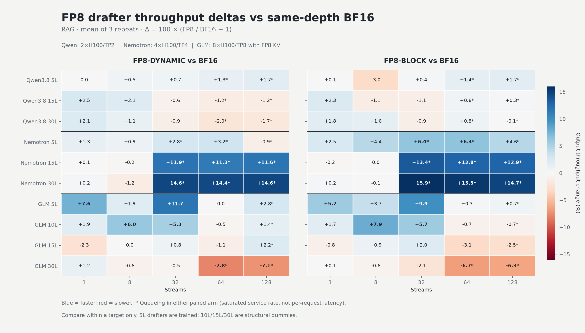
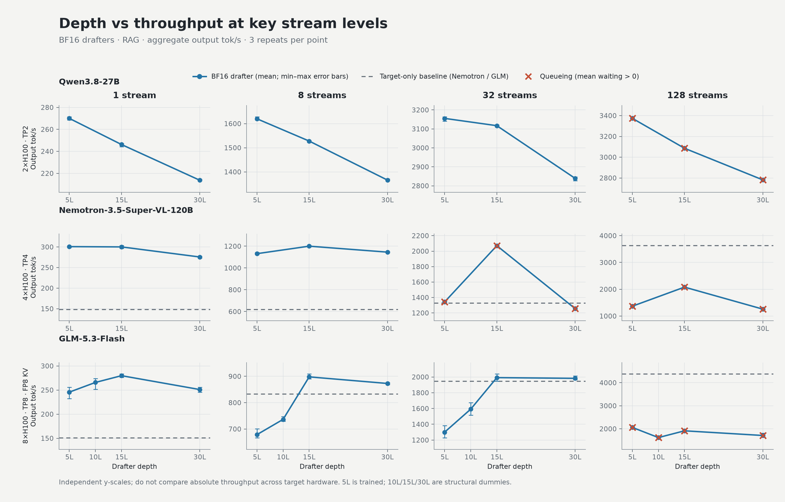
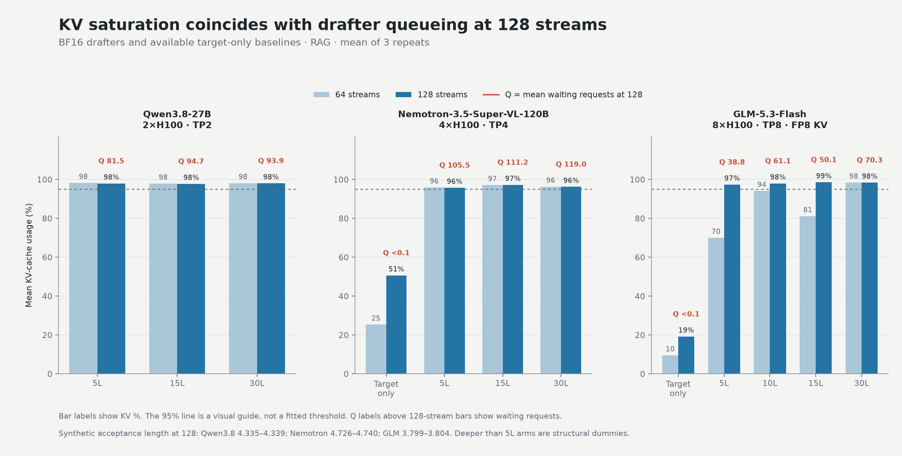

[{ .entry-avatar }](https://github.com/rahul-tuli)
**[@rahul-tuli](https://github.com/rahul-tuli)** posted on **2026-11-03**

# Drafter quantization and DSpark depth: calibration acceptance, FP8 serving, and KV-cache limits

## Abstract

We studied drafter quantization in two stages. First, a Qwen3-8B DFlash acceptance study compared BF16 with ten FP8 and NVFP4 checkpoints on RedHatAI/speculator_benchmarks and SpeedBench. Data-free FP8 dynamic and FP8 block quantization retained more than 98% of BF16 acceptance length on both suites. Gaussian calibration sharply reduced acceptance for every data-dependent configuration tested. Real PerfectBlend calibration recovered most acceptance for NVFP4 GPTQ, but the GPTQ+iMatrix arm retained 95.96% and 94.74% on the two suites—not the >98% sometimes used as a summary of this study.

Second, a DSpark serving sweep varied drafter depth and precision while pinning synthetic acceptance to model-card vectors. FP8 was close to BF16 at one stream and faster in selected loaded configurations, but not universally faster. Depth and baseline crossovers were target-specific: 15L was the low/mid-concurrency sweet spot on Nemotron and GLM, while Qwen favored 5L. At 128 streams, KV-cache exhaustion and queueing dominated the drafter arms; GLM's ranking inverted toward 5L. These are synthetic-acceptance throughput results, not measurements of trained-depth quality or real acceptance.

## Motivation

Quantizing a drafter can reduce its weight traffic and memory footprint, but a faster kernel is not useful if quantization destroys proposal acceptance. Separately, a deeper drafter may improve proposal quality in principle while costing draft compute and KV-cache headroom in serving. We therefore asked two distinct questions:

1. Which quantization and calibration choices preserve measured acceptance?
2. With acceptance held fixed synthetically, how do drafter precision and structural depth affect aggregate throughput, interactivity, memory pressure, and the crossover against target-only serving?

The first question uses real acceptance measurements on DFlash. The second deliberately removes acceptance variation to isolate serving effects on DSpark; the two phases should not be read as one end-to-end quality comparison.

## Methodology

### Phase 1: measured acceptance after quantization

- Target and drafter: `Qwen/Qwen3-8B` with `RedHatAI/Qwen3-8B-speculator.dflash`, BF16 baseline plus ten quantized checkpoints. This phase used **DFlash**, not DSpark.
- Algorithm and serving: DFlash with seven speculative tokens, TP1 on NVIDIA H100 80GB GPUs; run-specific vLLM commands, revisions, and patches are preserved in the evidence bundle.
- Calibration: Gaussian controls or 2,027 real PerfectBlend samples at sequence length 2,048, depending on the arm. FP8 dynamic and FP8 block were data-free.
- Evaluation: all nine `RedHatAI/speculator_benchmarks` subsets and all 11 SpeedBench qualitative categories; temperature 0, seed 0, up to 200 requests per subset, maximum concurrency 128, and a 4,096-token output cap. Prompt files were pinned within each suite.
- Analysis: one evaluation per arm. Pooled acceptance length is `1 + sum(accepted draft tokens) / sum(draft rounds)` within each suite, including the verifier/bonus token. Maximum acceptance length is therefore 8. Retention is the arm's pooled acceptance length divided by the BF16 value for the same suite.

### Phase 2: DSpark depth × precision serving sweep

Only the 5L drafters were trained. The 10L/15L/30L repositories were structural dummies: layer `i` copied base layer `i mod 5`, with the layer-count configuration changed accordingly. Qwen and Nemotron tested 5L/15L/30L; GLM also tested 10L. Every depth was run in BF16, FP8 block, and FP8 dynamic where applicable.

All drafter arms—including trained 5L BF16—used `rejection_sample_method=synthetic` with eight speculative tokens and the target's model-card acceptance vector. The resulting acceptance lengths stayed approximately flat (Qwen 4.31–4.38, Nemotron 4.70–4.76, GLM 3.78–3.83), so throughput differences were not driven by measured acceptance differences.

| Target                                               | Serving hardware          | Benchmark subsets       | Drafter depths | Target-only arm   |
| ---------------------------------------------------- | ------------------------- | ----------------------- | -------------- | ----------------- |
| `Qwen/Qwen3.8-27B`                                   | 2×H100, TP2               | `math_reasoning`, `rag` | 5L/15L/30L     | **Not collected** |
| `nvidia/NVIDIA-Nemotron-3.5-Super-VL-120B-A12B-BF16` | 4×H100 80GB, TP4          | `rag`                   | 5L/15L/30L     | `target_only`     |
| GLM-5.3-Flash, revision `46a050be`                   | 8×H100, TP8, FP8 KV cache | `rag`                   | 5L/10L/15L/30L | `no_speculator`   |

The common protocol used `scripts/evaluate/throughput_interactivity.py` on pinned `RedHatAI/speculator_benchmarks` data, streams 1/2/4/8/16/32/64/128, and three repeats per point. Streams 1–16 used 30 s warmup and 90 s measurement; streams 32–128 used 60 s and 120 s. Output was capped at 1,024 tokens and prefix caching was disabled. The 328 aggregated points below are means of three repeats, comprising 984 raw runs. Tables report aggregate output tokens/s, not per-user interactivity.

Nemotron and GLM also set `VLLM_MOE_ROUTING_SIMULATION_STRATEGY=uniform_random`. This is a performance-only routing simulation and makes model outputs invalid.

## Phase 1 findings: calibration determines whether acceptance survives

| Drafter configuration            | RedHatAI AL (retained) | SpeedBench AL (retained) |
| -------------------------------- | ---------------------: | -----------------------: |
| BF16 baseline                    |        3.316 (100.00%) |          3.271 (100.00%) |
| FP8 dynamic, data-free           |        3.317 (100.05%) |           3.269 (99.96%) |
| FP8 block, data-free             |         3.310 (99.83%) |           3.268 (99.92%) |
| FP8 static W8A8, Gaussian        |         1.490 (44.95%) |           1.435 (43.88%) |
| FP8 static W8A8, PerfectBlend    |         2.309 (69.65%) |           2.218 (67.80%) |
| NVFP4 W4A4, Gaussian             |         1.480 (44.65%) |           1.424 (43.54%) |
| NVFP4 W4A4, PerfectBlend         |         2.288 (69.02%) |           2.193 (67.06%) |
| NVFP4 GPTQ, Gaussian             |         2.188 (65.99%) |           2.096 (64.08%) |
| NVFP4 GPTQ, PerfectBlend         |         3.185 (96.06%) |           3.101 (94.81%) |
| NVFP4 GPTQ+iMatrix, Gaussian     |         2.201 (66.39%) |           2.108 (64.44%) |
| NVFP4 GPTQ+iMatrix, PerfectBlend |         3.182 (95.96%) |           3.099 (94.74%) |

- **Data-free FP8 preserved acceptance.** FP8 dynamic and FP8 block were the only configurations above 98% retention on both suites. Their small differences from BF16 are practical ties in these single-run measurements.
- **Gaussian calibration was inadequate for every data-dependent arm tested.** The largest drops were static FP8 and W4A4 NVFP4, which retained only about 44–45% of BF16 acceptance length. Real PerfectBlend data improved every corresponding Gaussian arm, but only the GPTQ pipelines approached BF16.
- **The >98% threshold does not include NVFP4.** Real-data NVFP4 GPTQ+iMatrix retained 95.96% on RedHatAI and 94.74% on SpeedBench. GPTQ without iMatrix was marginally higher, so this study did not demonstrate an iMatrix acceptance benefit.
- **Calibration necessity is not causally isolated for GPTQ.** Gaussian GPTQ runs used damping 0.01, whereas PerfectBlend runs used 0.10. Calibration data and damping changed together. The results show that the tested Gaussian configurations failed and that the real-data/damping-0.10 configurations recovered most acceptance; a damping-matched rerun is needed to attribute the recovery to real data alone.

## Phase 2 findings: serving behavior depends on target and load

### FP8 is near parity at one stream, with selected gains at 32 streams

At one stream, FP8/BF16 aggregate-throughput deltas across matched depths were −0.01% to +2.51% on Qwen (both subsets) and −0.19% to +2.49% on Nemotron. GLM spanned −2.32% to +7.56%; its +7.56% FP8-dynamic 5L result should be treated cautiously because the corresponding BF16 5L point had 9.57% repeat spread. Thus the narrow −0.2% to +2.5% parity summary fits Qwen and Nemotron, not every GLM arm.

The clearer gains appeared in particular 32-stream RAG configurations:

| Target and depth | BF16 tok/s | FP8 block delta | FP8 dynamic delta |
| ---------------- | ---------: | --------------: | ----------------: |
| Nemotron 15L     |    2,070.7 |         +13.39% |           +11.86% |
| Nemotron 30L     |    1,256.0 |         +15.89% |           +14.62% |
| GLM 5L           |    1,300.5 |          +9.87% |           +11.74% |

These gains were not universal. Qwen remained mostly near parity, and GLM 30L FP8 was slower than BF16 at several loaded points. The supported conclusion is that FP8 was throughput-neutral to beneficial in the tested low-load and selected mid-load configurations—not that quantization never hurts.

### Qwen3.8-27B: 5L leads or ties; no target-only speedup is available

Aggregate output tok/s, means of three repeats. Each cell group shows streams 1/16/32/128.

| Arm             | RAG: 1 / 16 / 32 / 128              | Math reasoning: 1 / 16 / 32 / 128   |
| --------------- | ----------------------------------- | ----------------------------------- |
| BF16 5L         | 270.0 / 2,489.6 / 3,155.3 / 3,374.0 | 266.4 / 2,627.4 / 3,631.0 / 3,872.3 |
| BF16 15L        | 246.2 / 2,422.9 / 3,116.9 / 3,085.8 | 243.1 / 2,629.2 / 3,553.7 / 3,593.8 |
| BF16 30L        | 213.7 / 2,176.7 / 2,839.3 / 2,781.7 | 217.6 / 2,399.3 / 3,261.6 / 3,322.0 |
| FP8 block 5L    | 270.2 / 2,481.2 / 3,166.8 / 3,432.6 | 268.9 / 2,682.5 / 3,616.9 / 3,768.4 |
| FP8 block 15L   | 251.9 / 2,419.4 / 3,083.3 / 3,093.9 | 244.5 / 2,616.1 / 3,524.6 / 3,635.6 |
| FP8 block 30L   | 217.7 / 2,188.6 / 2,814.0 / 2,779.9 | 219.7 / 2,416.6 / 3,247.8 / 3,350.8 |
| FP8 dynamic 5L  | 270.0 / 2,494.4 / 3,175.9 / 3,430.5 | 267.8 / 2,700.9 / 3,628.9 / 3,832.3 |
| FP8 dynamic 15L | 252.4 / 2,435.3 / 3,097.4 / 3,049.4 | 244.5 / 2,590.5 / 3,510.5 / 3,579.2 |
| FP8 dynamic 30L | 218.3 / 2,171.3 / 2,813.7 / 2,734.8 | 219.7 / 2,400.2 / 3,224.7 / 3,245.2 |

Qwen does **not** show a general 15L sweet spot. BF16 5L leads at one stream and at 32 streams on both subsets; at 16 streams it leads on RAG and effectively ties 15L on math_reasoning. It also leads the BF16 arms at 128 streams. No target-only arm was collected, so this sweep cannot support a Qwen speculative-versus-baseline speedup or crossover claim.

### Nemotron: 15L leads under load, and FP8 extends the baseline advantage

Aggregate output tok/s on RAG, means of three repeats.

| Arm             |     1 |       8 |      16 |      32 |      64 |     128 |
| --------------- | ----: | ------: | ------: | ------: | ------: | ------: |
| Target only     | 148.7 |   620.9 |   897.0 | 1,329.3 | 2,176.9 | 3,636.1 |
| BF16 5L         | 300.8 | 1,131.5 | 1,824.8 | 1,342.9 | 1,344.3 | 1,367.5 |
| BF16 15L        | 300.1 | 1,200.2 | 2,008.5 | 2,070.7 | 2,077.8 | 2,080.1 |
| BF16 30L        | 275.6 | 1,145.5 | 1,255.3 | 1,256.0 | 1,259.5 | 1,258.9 |
| FP8 block 5L    | 308.3 | 1,181.3 | 1,974.7 | 1,428.4 | 1,430.0 | 1,429.8 |
| FP8 block 15L   | 299.6 | 1,200.2 | 2,012.8 | 2,348.0 | 2,344.4 | 2,347.4 |
| FP8 block 30L   | 276.3 | 1,144.2 | 1,446.8 | 1,455.6 | 1,454.6 | 1,443.4 |
| FP8 dynamic 5L  | 304.7 | 1,141.4 | 1,844.4 | 1,380.0 | 1,387.4 | 1,355.3 |
| FP8 dynamic 15L | 300.3 | 1,197.9 | 1,986.1 | 2,316.4 | 2,312.6 | 2,322.0 |
| FP8 dynamic 30L | 276.1 | 1,131.3 | 1,440.0 | 1,439.6 | 1,440.8 | 1,442.1 |

BF16 5L delivered 2.02× target-only throughput at one stream; across all drafter arms the range was 1.85–2.07×. At 32 streams the arm-dependent ratio was 0.94–1.77×, and at 64 it was 0.58–1.08×. FP8 15L remained above baseline at 64 streams, while BF16 15L was slightly below it and 5L arms had already crossed below. Every drafter arm was below baseline at 128 streams (0.35–0.65×). There is therefore no single crossover stream shared by all arms.

### GLM: 15L wins at low/mid load, then 5L regains the lead at 128 streams

Aggregate output tok/s on RAG at temperature 0, means of three repeats.

| Arm             |     1 |     8 |      16 |      32 |      64 |     128 |
| --------------- | ----: | ----: | ------: | ------: | ------: | ------: |
| No speculator   | 151.0 | 832.9 | 1,281.9 | 1,946.4 | 2,999.5 | 4,380.6 |
| BF16 5L         | 245.7 | 678.7 |   989.7 | 1,300.5 | 1,572.6 | 2,061.0 |
| BF16 10L        | 265.8 | 736.5 | 1,136.6 | 1,592.4 | 1,659.6 | 1,619.8 |
| BF16 15L        | 279.8 | 897.9 | 1,345.3 | 1,991.7 | 1,765.0 | 1,913.2 |
| BF16 30L        | 251.0 | 872.9 | 1,318.1 | 1,982.4 | 1,734.2 | 1,710.8 |
| FP8 block 5L    | 259.7 | 703.6 |   985.0 | 1,428.8 | 1,577.5 | 2,075.8 |
| FP8 block 10L   | 270.2 | 795.0 | 1,156.4 | 1,683.6 | 1,648.5 | 1,609.2 |
| FP8 block 15L   | 277.5 | 905.8 | 1,377.2 | 2,032.1 | 1,710.5 | 1,864.7 |
| FP8 block 30L   | 251.3 | 867.9 | 1,318.5 | 1,941.0 | 1,617.5 | 1,603.5 |
| FP8 dynamic 5L  | 264.2 | 691.6 | 1,041.4 | 1,453.2 | 1,572.3 | 2,118.3 |
| FP8 dynamic 10L | 270.7 | 780.9 | 1,169.4 | 1,676.3 | 1,651.7 | 1,642.5 |
| FP8 dynamic 15L | 273.3 | 897.8 | 1,372.1 | 2,007.5 | 1,746.1 | 1,956.1 |
| FP8 dynamic 30L | 254.1 | 867.4 | 1,311.7 | 1,972.9 | 1,599.5 | 1,588.8 |

At one stream, drafters delivered 1.63–1.85× target-only throughput. The 15L arm led within each precision from 1 through 32 streams, including a 1.02–1.04× ratio at 32. All arms were below baseline at 64 (0.52–0.59×) and at 128 (0.36–0.48×). The 5L arms were already below baseline at 8 streams, so “parity at 32” applies only to the leading deeper arms.

At 128 streams, 5L became the fastest depth for every precision. For BF16, the one-stream order was 15L > 10L > 30L > 5L (279.8 > 265.8 > 251.0 > 245.7 tok/s), but the 128-stream order was 5L > 15L > 30L > 10L (2,061.0 > 1,913.2 > 1,710.8 > 1,619.8). The remaining order varied by precision. This inversion was not universal across targets: Nemotron 15L still led at 128, and Qwen 5L already led at lower load.

### KV saturation explains the high-load pattern better than acceptance

The following RAG examples show BF16 arms at 128 streams. FP8 arms showed the same pattern. Acceptance length remained pinned while drafter KV usage approached capacity and requests queued.

| Target   | Arm           | KV usage | Mean waiting requests |
| -------- | ------------- | -------: | --------------------: |
| Qwen     | BF16 5L       |   97.96% |                 81.48 |
| Qwen     | BF16 15L      |   97.79% |                 94.68 |
| Qwen     | BF16 30L      |   98.07% |                 93.88 |
| Nemotron | Target only   |   50.68% |                  0.02 |
| Nemotron | BF16 5L       |   95.76% |                105.47 |
| Nemotron | BF16 15L      |   97.25% |                111.25 |
| Nemotron | BF16 30L      |   96.25% |                118.97 |
| GLM      | No speculator |   19.21% |                  0.01 |
| GLM      | BF16 5L       |   97.39% |                 38.78 |
| GLM      | BF16 10L      |   98.00% |                 61.06 |
| GLM      | BF16 15L      |   98.57% |                 50.12 |
| GLM      | BF16 30L      |   98.42% |                 70.29 |

Across all 128-stream drafter points, KV usage was 95.6–98.8%. Mean waiting was 38.0–70.3 on GLM, 78.4–94.7 on Qwen, and 105.4–119.0 on Nemotron. With acceptance held fixed and drafter memory trading against the target KV pool under a fixed memory budget, the high-load rankings are consistent with a KV-headroom limit rather than a change in proposal acceptance. They do not by themselves eliminate every compute-related contribution.

## Caveats and open follow-up

- **Synthetic acceptance and throughput only.** Every Phase 2 drafter arm used synthetic rejection sampling. The throughput results are not real acceptance, output-quality, or accuracy measurements, and must not be used to claim that a deeper trained drafter would preserve the same acceptance.
- **Dummy layers.** Only 5L drafters were trained. The 10L/15L/30L structural duplicates price latency, memory, and throughput; their behavior is an artifact of duplicated weights.
- **Queueing invalidates latency interpretations at saturated points.** Queued 64/128-stream points—and earlier queued points on Qwen and Nemotron—measure saturated service rate, not per-request latency. TTFT and ITL at those points are not clean latency characterizations. Repeat spread also makes small differences unreliable on some arms.
- **MoE routing simulation.** Nemotron and GLM used `uniform_random` routing simulation for performance only. Their generated outputs were invalid by design.
- **No absolute cross-target comparisons.** GPU count, tensor parallelism, target, workload subsets, and KV configuration differ. Compare trends and ratios within a target, not absolute tokens/s across targets. GLM alone used FP8 KV cache.
- **Missing Qwen baseline.** Qwen has no target-only arm, so no Qwen baseline speedup or crossover is reported. Its 64/128-stream drafter points also queue heavily.
- **Phase 1 uncertainty and confounding.** Acceptance arms were single runs without confidence intervals. GPTQ calibration and damping changed together, so a damping-matched comparison remains necessary.
- **Phase 3 NVFP4 is an open follow-up, not a result.** It is pending Eldar Kurtic's verification of the Phase 1 acceptance findings. If verified, the proposed comparison is 15L/30L NVFP4 against FP8 at 32–64 streams on memory-tight targets, with real acceptance checked before using synthetic acceptance for serving measurements.

## Reproduction pointers

The normalized measurements, canonical report, and saved commands are included with this entry. Paths in the archived commands reflect the original run hosts and need to be adapted to a new environment.

- Phase 1 acceptance data:
  - [All 11 checkpoints, pooled by suite](../assets/research/dspark-depth-quantization/phase1-overall-acceptance-length.csv)
  - [Per-subset acceptance measurements](../assets/research/dspark-depth-quantization/phase1-acceptance-by-subset.csv)
  - [NVFP4 pooled counters](../assets/research/dspark-depth-quantization/phase1-nvfp4-overall-summary.csv) and [source hashes and metric metadata](../assets/research/dspark-depth-quantization/phase1-plot-manifest.json)
  - Representative GPTQ+iMatrix PerfectBlend provenance: [evaluation commands](../assets/research/dspark-depth-quantization/provenance/phase1/redhatai-speculator-benchmarks-nvfp4-gptq-imatrix-perfectblend/eval_command.txt), [vLLM command](../assets/research/dspark-depth-quantization/provenance/phase1/redhatai-speculator-benchmarks-nvfp4-gptq-imatrix-perfectblend/vllm_command.txt), [vLLM patch](../assets/research/dspark-depth-quantization/provenance/phase1/redhatai-speculator-benchmarks-nvfp4-gptq-imatrix-perfectblend/vllm.patch), [target checksum](../assets/research/dspark-depth-quantization/provenance/phase1/redhatai-speculator-benchmarks-nvfp4-gptq-imatrix-perfectblend/checkpoint_sha256.txt), and [drafter checksum](../assets/research/dspark-depth-quantization/provenance/phase1/redhatai-speculator-benchmarks-nvfp4-gptq-imatrix-perfectblend/drafter_checkpoint_sha256.txt).
- Phase 2 serving data:
  - [Self-contained interactive report](../assets/research/dspark-depth-quantization/report.html)
  - [328 three-repeat aggregates as CSV](../assets/research/dspark-depth-quantization/combined-summary.csv), including repeat min/max, throughput, interactivity, ITL, acceptance length, KV usage, waiting requests, and TTFT
  - Full serving and evaluation commands: [Qwen runner](../assets/research/dspark-depth-quantization/provenance/qwen/run_sweep.sh), [Nemotron runner](../assets/research/dspark-depth-quantization/provenance/nemotron/run_synthetic_sweep_after_target_only.sh), and [GLM runner](../assets/research/dspark-depth-quantization/provenance/glm/run_matrix.sh).
- Evaluation implementation: [`scripts/evaluate/throughput_interactivity.py`](https://github.com/vllm-project/speculators/blob/main/scripts/evaluate/throughput_interactivity.py). Use the saved run commands and pinned model/dataset revisions for reproduction, and preserve provenance with `--provenance-dir` when launching through `scripts/launch_vllm.py`.
