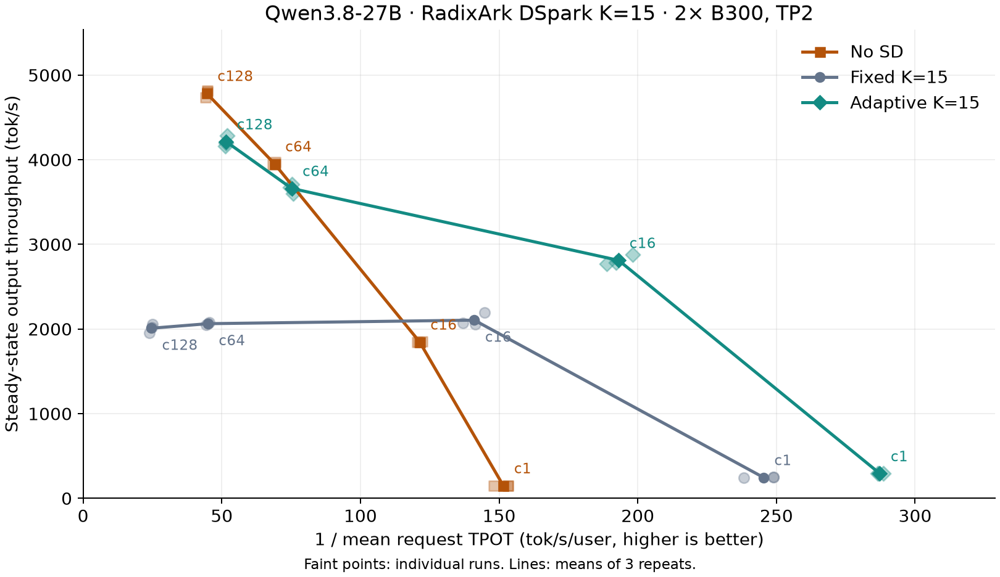

[{ .entry-avatar }](https://github.com/tomasruizt)
**[@tomasruizt](https://github.com/tomasruizt)** posted on **2026-10-27**

# DSpark and GDN: does adaptive verification help with a larger draft?

## Summary

Adaptive verification (AV) improved throughput over fixed K=15 by 17–108% with Qwen3.8-27B and RadixArk's DSpark v2 drafter. It helped even at concurrency 1, where profiling showed that verifying fewer tokens saves GDN recurrence work. Turning speculation off still gave the highest throughput at concurrency 64 and 128.

We ran this to check whether GDN could support a 16-token verification window through its Triton fallback, beyond the fused CUDA kernel's limit of 8. Removing the graph limit while retaining the fused kernel's guard worked with real requests under FULL CUDA graph replay.

## Results

We compared no speculation, fixed K=15, and K=15 with AV on two B300s (TP2, BF16), using SPEED-Bench `throughput_1k`. Each setting has three repeats. Tables show medians, and the plot connects means with individual runs shown faintly.

Higher and further right is better. The x-axis is inverse mean request TPOT in tok/s/user, and the y-axis is aggregate output throughput in tok/s.

AV beat fixed K=15 throughout the sweep. The difference grew with concurrency, reaching about 2× at c128. But the target-only baseline changes the conclusion: at c64 and c128, AV still lost on throughput. It had lower TPOT, so the choice depends on whether throughput or per-user decode speed matters more.

| Concurrency | Target-only tok/s | Fixed K=15 tok/s | AV tok/s | AV / target-only | AV / fixed |
| ----------: | ----------------: | ---------------: | -------: | ---------------: | ---------: |
|           1 |               151 |              250 |      292 |            1.93× |      1.17× |
|          16 |             1,847 |            2,070 |    2,786 |            1.51× |      1.35× |
|          64 |             3,947 |            2,064 |    3,672 |            0.93× |      1.78× |
|         128 |             4,799 |            2,022 |    4,196 |            0.87× |      2.08× |

TPOT and acceptance length by concurrency

The acceptance lengths were modest on this workload, roughly three tokens per step. AL includes the bonus/replacement token, so an AL of 3 means about two accepted draft tokens plus one token from the target.

AL can change with concurrency because timed runs cover different mixes of requests, and AV can also change how many draft tokens it verifies.

| Concurrency | Target-only TPOT (ms) | Fixed TPOT (ms) | AV TPOT (ms) | Fixed AL | AV AL |
| ----------: | --------------------: | --------------: | -----------: | -------: | ----: |
|           1 |                 6.529 |           4.017 |        3.485 |     2.59 |  2.74 |
|          16 |                 8.251 |           7.072 |        5.202 |     3.33 |  3.16 |
|          64 |                14.437 |          22.172 |       13.261 |     3.32 |  3.15 |
|         128 |                22.343 |          40.493 |       19.440 |     3.19 |  2.94 |

### Why AV helps even at concurrency 1

The c1 result surprised us. With only one request, extra draft tokens are often assumed to be almost free because they reuse the target's weights. Why would verifying fewer of them help?

We checked with CUDA events and Nsight Systems, running the same eight SPEED-Bench prompts with and without AV. AV reduced the average number of positions verified from 16 to 6.17, while producing almost the same number of output tokens per step. Target time fell from 8.47 to 7.56 ms, while drafter time stayed at 1.51 ms. The drafter still proposed all 15 candidates. The saving came from the target doing less verification work.

GDN explains much of that saving. It updates recurrent state for each verified token, so extra positions still cost time at c1. Across the 48 GDN layers, recurrence time fell from 1.114 to 0.495 ms per step per GPU. That accounts for about two thirds of the target-time reduction in the Nsight trace.

C1 query lengths, output tokens, and stage timings

| Per decode step                     | Fixed K=15 |       AV |
| ----------------------------------- | ---------: | -------: |
| Mean target query length            |         16 |     6.17 |
| Mean emitted tokens                 |       2.60 |     2.64 |
| Target GPU time                     |    8.47 ms |  7.56 ms |
| Drafter GPU time                    |    1.51 ms |  1.51 ms |
| Total worker GPU time               |   10.41 ms |  9.53 ms |
| GDN recurrence kernel time, per GPU |   1.114 ms | 0.495 ms |

Here is the broader Nsight breakdown. Each row adds up that family's kernel time and reports it per step per GPU. The last column shows its share of the total net saving of 1.079 ms. Negative values mean that family became more expensive with AV.

| Kernel family                               | Fixed SD (ms/step/GPU) | AV (ms/step/GPU) | Saving (ms/step/GPU) | % of total kernel-time saving |
| ------------------------------------------- | ---------------------: | ---------------: | -------------------: | ----------------------------: |
| GDN recurrence                              |                  1.114 |            0.495 |                0.619 |                         57.3% |
| Matrix multiplication and split-K reduction |                  6.569 |            6.099 |                0.470 |                         43.5% |
| All-reduce                                  |                  1.035 |            0.951 |                0.084 |                          7.8% |
| Causal convolution                          |                  0.243 |            0.193 |                0.050 |                          4.6% |
| Normalization                               |                  0.164 |            0.158 |                0.006 |                          0.6% |
| Standard attention                          |                  0.329 |            0.341 |               −0.012 |                         −1.1% |
| Other kernels                               |                  1.357 |            1.495 |               −0.138 |                        −12.7% |
| **Total**                                   |             **10.811** |        **9.732** |            **1.079** |                    **100.0%** |

**GDN recurrence and matrix multiplication provide most of the saving.** Convolution and communication contribute smaller gains. Standard attention does not become faster, and total drafter time stays unchanged.

These kernel totals cover the whole capture, including drafter and prefill work. Some kernels overlap, so a 1 ms reduction in their summed durations does not necessarily save 1 ms of elapsed time. The profiles also used a different B300 pair from the main sweep. They show why AV helps, but do not account for every part of the sweep's speedup.

## What is still missing?

We would next compare smaller fixed K values and a simple policy that changes K with batch size. Those comparisons would tell us whether AV is the best choice, rather than just a better choice than always verifying 15 drafts.

The three methods ran consecutively, not interleaved, so these repeats do not rule out startup differences or drift on a shared machine. We only profiled c1. We have not located a compute-bound crossover or measured which operations cause the c128 throughput deficit.

## Appendix

Why K=15, and which code changes were tested?

While reviewing [vLLM PR #60229](https://github.com/vllm-project/vllm/pull/60229), we found that GDN's maximum query length for variable-length CUDA graphs was capped at 8. That matches the fused CUDA kernel's limit, but GDN also has a Triton fallback that handles longer queries. The graph limit was therefore preventing configurations that the fallback should support.

We wanted to test that distinction with real requests: remove the graph limit, leave the fused kernel's guard in place, and check that longer queries run correctly through Triton under CUDA graph replay.

We chose a DSpark checkpoint trained with block size 16 and explicitly set K=15. That gives the target up to 16 input tokens per request: one existing token plus 15 draft tokens. This goes beyond the fused kernel's limit and gives AV room to choose how much of the draft to verify.

There was also a performance question. A large draft may help when few requests are running, but verifying it in full can waste work at higher concurrency. Can AV avoid that waste? To find out, we compared three choices: no speculation, fixed K=15, and K=15 with AV.

Models, hardware, and benchmark setup

- Target: [Qwen3.8-27B](https://huggingface.co/Qwen/Qwen3.8-27B/tree/1d4bf0f2ff6012fd82039f2fa52739d0dd7c60c0), with 48 GDN layers and 16 standard attention layers.
- Drafter: [RadixArk's DSpark v2](https://huggingface.co/RadixArk/Qwen3.8-27B-DSpark/tree/b9a5dbdf03bc999c6c73c426b19c2d9041cea393). Its training block size is 16, but its serving default is 7, so we explicitly selected K=15. We used the published weights without further training.
- Hardware: two B300 GPUs, TP2, BF16 for both models.
- Code: [c3e701c8bf](https://github.com/tomasruizt/vllm/commit/c3e701c8bf0424e467008dddff0ecb6b603dae1b) (the exact benchmark source, based on PR #60229's 2026-10-26 snapshot). This includes the graph-limit removal, sparse indexer simplification, and the revert of the capture conditional for `num_decode_draft_tokens_cpu`.
- Workload: [SPEED-Bench](https://huggingface.co/datasets/nvidia/SPEED-Bench) `throughput_1k`, measured with AIPerf 0.13.0. Temperature 0, thinking disabled, natural EOS, output capped at 1,024 tokens.

We tested concurrency 1, 16, 64, and 128, with three repeats per setting. We kept each method's server running across its repeats to avoid repeated startup costs, and disabled prefix caching so later runs would not benefit from earlier prompts. The three methods ran one after another on the same GPU pair, using the same shuffle seed of 42.

All 36 runs completed successfully: 6,755 requests, with no errors, cancellations, or preemptions. We measured performance without profiling hooks. Separate runs checked which code paths executed and where GPU time was spent. To compare steady serving performance, we left out the initial fill and final drain.

Correctness and execution checks

| GSM8K, first 100 test questions, five-shot | Correct |
| ------------------------------------------ | ------: |
| Target-only                                |  98/100 |
| Fixed K=15                                 |  99/100 |
| AV, K=15                                   |  99/100 |

We also needed to check that the longer verification path still produced sensible answers. On the first 100 GSM8K test questions, fixed SD and AV gave the same numeric answer every time, with identical text on 88 questions. Both differed from target-only on one answer. None were invalid or hit the output cap. This is a small correctness check, not evidence that speculation improves accuracy.

Acceptance was much higher here: fixed K=15 reached AL 6.57 on GSM8K, compared with 2.59 at c1 on SPEED-Bench. Low acceptance on one workload does not by itself establish that the drafter is poor.

To check the original implementation question, we recorded FULL graph replay with query lengths up to 16, including requests of different lengths in the same batch, such as `[10, 14]`. The trace confirmed the Triton GDN fallback. We also exercised mixed prefill/decode batches, and all 65 GDN metadata tests passed. The fused CUDA kernel's width guard remained in place throughout.

Reproduction commands and data

The commands and pinned model revisions are linked below. We extended the graph capture sizes because K=15 creates larger target and drafter batches. Without enough graph coverage, eager execution could obscure the comparison.

- [Server commands, software versions, pinned model downloads, and benchmark instructions](../assets/research/dspark-gdn-block16/vllm_command.txt)
- [Exact vLLM source commit](https://github.com/tomasruizt/vllm/commit/c3e701c8bf0424e467008dddff0ecb6b603dae1b) (benchmark snapshot including all local source changes)
- AIPerf configs: [target-only](../assets/research/dspark-gdn-block16/baseline-sweep.yaml), [fixed K=15](../assets/research/dspark-gdn-block16/fixed-sweep.yaml), [AV](../assets/research/dspark-gdn-block16/adaptive-sweep.yaml)
- GSM8K: [evaluation command](../assets/research/dspark-gdn-block16/eval_command.txt) and [evaluation client](../assets/research/dspark-gdn-block16/eval_gsm8k.py.txt) (save as `eval_gsm8k.py`)
- [All 36 per-run measurements](../assets/research/dspark-gdn-block16/measurements.csv)
- C1 profiles: [CUDA-event stage timings](../assets/research/dspark-gdn-block16/c1-stage-timings.csv) and [Nsight GDN recurrence timings](../assets/research/dspark-gdn-block16/c1-gdn-timings.json). CPU and GPU stage durations overlap and must not be added together.

Measurement and software details

We used AIPerf's native SPEED-Bench loader. Mean input lengths per run ranged from 1,062 to 1,087 tokens, and mean output lengths from 619 to 929 tokens. All runs passed checks for completion, server saturation, queueing, preemptions, and a usable steady window.

The throughput window starts at the concurrency-th request completion and ends at the last request submission. We estimate tokens inside it by distributing each request's output count evenly across its streamed chunks. TPOT is the mean request TPOT for requests submitted inside the window. The shortest window was 10.40 seconds. AL uses server counter deltas over the full client measurement interval: `1 + accepted draft tokens / speculative steps`.

GSM8K used the first five training examples as demonstrations, concurrency 16, temperature 0, seed 42, thinking disabled, and a 1,024-token cap. Runtime checks confirmed `sample_from_anchor=True`, 15 drafter query tokens per request, and confidence-head use on both TP ranks. The sampling configuration was `draft_sample_method=probabilistic` with temperature 0.

The stage timings use CUDA events with Nsight capture stopped. The kernel breakdown comes from the Nsight trace. Both profile GPUs held 2,032 MHz, and client TPOT differed by less than 0.13% with Nsight capture on versus off. GDN ran 48 recurrence calls per GPU per decode step, averaging 23.21 µs each without AV and 10.32 µs with AV.

Software: Python 3.12.13, PyTorch 2.13.0+cu130, CUDA 13.0, Transformers 5.17.0, Triton 3.7.1, AIPerf 0.13.0. The recorded Python source ran with precompiled vLLM extensions `0.30.1rc1.dev17+g8d3f2b65c.precompiled`. Each B300 SXM6 reported 275,040 MiB of memory, with driver 610.43.02. We did not use Speculators to train or serve these checkpoints.

Additional limitations and run notes

- Output lengths and the requests included in each measurement differ, so throughput and mean TPOT are not exact reciprocals at a fixed nominal concurrency.
- The model revisions are pinned, but we did not generate weight checksum manifests or record the cached SPEED-Bench dataset's revision and checksum.
- The outer launch script reported a shell error after the benchmark runner had finished. We checked the runner's successful exit, each method's completion marker, and all 36 valid measurement exports separately.

