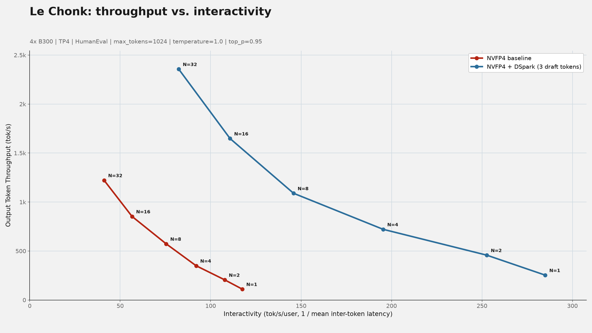

<div class="entry-byline" markdown>
[{ .entry-avatar }](https://github.com/MeganEFlynn)
**[@MeganEFlynn](https://github.com/MeganEFlynn)** posted on **2026-10-30**
</div>

# DSpark acceptance on Mistral Large 4 NVFP4: bundled drafter accepts ~1.6–2.3 of 3 draft tokens across the speculator_benchmarks suite

## Summary

Serving `mistralai/Mistral-Large-4-1T-A52B-NVFP4` (1T-A52B MoE, day-0 vLLM support) with its bundled DSpark drafter at depth 3 on 4 × B300, the measured acceptance length spans 2.62–3.29 across all nine `speculator_benchmarks` subsets at temperature 1.0 / top-p 0.95 (best: math_reasoning 3.29; worst: qa 2.62); greedy decoding on the first two subsets measured raised AL by ~0.17 (3.33 HumanEval / 3.48 math_reasoning). In the throughput sweep (streams 1–32, HumanEval) DSpark depth 3 delivers 1.9–2.4× higher aggregate output and per-user interactivity than the target-only baseline, with mean ITL falling 8.51 → 3.51 ms at one stream. The drafter's trained depth is exactly 3; requesting `num_speculative_tokens=8` prevents the server from starting.

## Setup

- Target model: `mistralai/Mistral-Large-4-1T-A52B-NVFP4`, revision `bb6d00fe249b0e876f0cffc6b85014be02de3e68`, NVFP4 experts + FP8 attention/shared experts (568.15 GiB, 32 shards)
- Draft model: DSpark drafter bundled in the same checkpoint (`mtp_dspark.*` tensors); no separate draft path or conversion
- Algorithm: DSpark, `num_speculative_tokens=3` (the only supported depth — see Observations)
- Evaluation: `RedHatAI/speculator_benchmarks`, all nine subsets (HumanEval, math_reasoning, qa, question, rag, summarization, tool_call, translation, writing; no MRCR — that is a separate evaluator mode), up to 80 requests per subset, max-concurrency 1; two sampling settings: temperature 1.0 / top-p 0.95 (Mistral-recommended) and temperature 0.0 / top-p 1.0 (greedy)
- Serving: `vllm/vllm-openai:mistral-large-4` image, `--tensor-parallel-size 4 --kv-cache-dtype fp8_ds_mla --gpu-memory-utilization 0.85 --max-model-len 32768 --max-num-seqs 8`; engine selected FLASHMLA_SPARSE + FP8 block-scaled GEMMs + NVFP4 MoE (FLASHINFER_TRTLLM)
- Software: Speculators commit `07b4fcf`, guidellm 0.8.1, client Python 3.11
- Hardware: 4 × NVIDIA B300 SXM6 AC (275 GB each), TP4

**Acceptance-length definition:** `1 + accepted_draft_tokens / drafting_steps`, i.e. it includes the single guaranteed verifier token. Maximum is 4 at draft depth 3. Per-position acceptance rates are conditional on all earlier draft positions being accepted.

## Reproduction

Server (note: the `vllm/vllm-openai` image entrypoint is already `vllm serve`, so the model and flags are passed as container args):

```bash
docker run -d --gpus '"device=0,1,2,3"' --ipc=host -v /data:/data \
  -e HF_HOME=/data/hf-home -e HF_HUB_OFFLINE=1 -p 8000:8000 \
  vllm/vllm-openai:mistral-large-4 \
  mistralai/Mistral-Large-4-1T-A52B-NVFP4 \
  --host 0.0.0.0 --port 8000 --tensor-parallel-size 4 \
  --speculative-config '{"method":"dspark","num_speculative_tokens":3}' \
  --kv-cache-dtype fp8_ds_mla --gpu-memory-utilization 0.85 \
  --max-model-len 32768 --max-num-seqs 8 \
  --tool-call-parser mistral --enable-auto-tool-choice --reasoning-parser mistral
```

Client, from the Speculators repository root (Python 3.11+ environment with `guidellm` on `PATH`):

```bash
python scripts/evaluate/evaluate.py throughput \
  --target http://localhost:8000/v1 \
  --dataset RedHatAI/speculator_benchmarks \
  --subsets HumanEval,math_reasoning \
  --max-requests 80 --max-concurrency 1 \
  --gen-kwargs '{"temperature":1.0,"top_p":0.95}' \
  --output-dir ./results/le_chonk_nvfp4_dspark        # sampled
python scripts/evaluate/evaluate.py throughput \
  --target http://localhost:8000/v1 \
  --dataset RedHatAI/speculator_benchmarks \
  --subsets HumanEval,math_reasoning \
  --max-requests 80 --max-concurrency 1 \
  --gen-kwargs '{"temperature":0.0,"top_p":1.0}' \
  --output-dir ./results/le_chonk_nvfp4_dspark_greedy  # greedy
```

## Results

Acceptance length (includes verifier token; max 4). Target-only baseline rows are N/A: without a drafter there are no draft tokens to accept, and the `vllm:spec_decode_*` counters are absent from `/metrics`.

| Configuration | Subset | Drafts | Accepted draft tokens | Acceptance length | Pos 0 | Pos 1 | Pos 2 |
|---------------|--------|--------|-----------------------|-------------------|-------|-------|-------|
| DSpark depth 3, T=1.0 / top-p 0.95 | HumanEval | 46,899 | 102,027 | 3.175 | 0.852 | 0.718 | 0.605 |
| DSpark depth 3, T=1.0 / top-p 0.95 | math_reasoning | 10,560 | 24,217 | 3.293 | 0.878 | 0.759 | 0.655 |
| DSpark depth 3, T=1.0 / top-p 0.95 | qa | 28,576 | 46,167 | 2.616 | 0.734 | 0.518 | 0.364 |
| DSpark depth 3, T=1.0 / top-p 0.95 | question | 50,259 | 82,374 | 2.639 | 0.738 | 0.525 | 0.377 |
| DSpark depth 3, T=1.0 / top-p 0.95 | rag | 26,719 | 53,194 | 2.991 | 0.820 | 0.657 | 0.515 |
| DSpark depth 3, T=1.0 / top-p 0.95 | summarization | 21,293 | 38,988 | 2.831 | 0.790 | 0.600 | 0.441 |
| DSpark depth 3, T=1.0 / top-p 0.95 | tool_call | 16,875 | 31,091 | 2.842 | 0.779 | 0.600 | 0.464 |
| DSpark depth 3, T=1.0 / top-p 0.95 | translation | 28,448 | 57,723 | 3.029 | 0.828 | 0.667 | 0.534 |
| DSpark depth 3, T=1.0 / top-p 0.95 | writing | 50,588 | 82,273 | 2.626 | 0.733 | 0.521 | 0.372 |
| DSpark depth 3, greedy | HumanEval | 40,614 | 94,627 | 3.330 | 0.890 | 0.775 | 0.664 |
| DSpark depth 3, greedy | math_reasoning | 9,601 | 23,851 | 3.484 | 0.917 | 0.828 | 0.740 |

| Target only (no drafter) | — | N/A | N/A | N/A | N/A | N/A | N/A |

Greedy rows above are from the first two-subset pass; a full greedy run across all nine subsets is in collection and will replace them. `speculator_benchmarks` ships nine subsets (no MRCR — that is a separate mode of the evaluator, not run here).

Speculator-disabled reference (same flags minus `--speculative-config`, `--max-num-seqs 32`, prefix caching off, `--max-num-batched-tokens 8192`): the evaluator confirms no `vllm:spec_decode_*` counters exist, so acceptance length is N/A by construction. On the same workload (HumanEval + math_reasoning, 80 requests per subset, concurrency 1) the target-only server produced 105.0 output tok/s at T=1.0/top-p 0.95, versus 232.5 tok/s with DSpark depth 3 — ~2.2× at concurrency 1.

## Throughput and interactivity

`throughput_interactivity.py collect` on HumanEval (`max_tokens=1024`, temperature 1.0 / top-p 0.95, 100 s per point after 30 s warmup, streams 1–32). Both configs ran sequentially on the same four GPUs with identical server flags except `--speculative-config` (sweep config: `--max-num-seqs 32`, prefix caching off, `--max-num-batched-tokens 8192` — differs from the acceptance config above).

| Streams | Baseline tok/s | DSpark tok/s | Aggregate speedup | Baseline 1/ITL (tok/s/user) | DSpark 1/ITL (tok/s/user) | Per-user speedup |
|---------|---------------|--------------|-------------------|------------------------------|---------------------------|------------------|
| 1 | 111.2 | 253.7 | 2.28× | 117.4 | 284.9 | 2.43× |
| 2 | 205.4 | 457.6 | 2.23× | 107.8 | 252.6 | 2.34× |
| 4 | 349.7 | 721.2 | 2.06× | 92.0 | 195.4 | 2.12× |
| 8 | 573.3 | 1,089.2 | 1.90× | 75.4 | 145.8 | 1.93× |
| 16 | 853.1 | 1,647.9 | 1.93× | 56.6 | 110.7 | 1.96× |
| 32 | 1,222.2 | 2,356.6 | 1.93× | 41.1 | 82.4 | 2.00× |

Mean inter-token latency drops from 8.51 → 3.51 ms at one stream and 24.33 → 12.14 ms at 32 streams. Neither config queues (`mean_waiting_requests` ≈ 0 at every level). Acceptance length measured during the sweep was 3.12–3.18, consistent with the acceptance table (HumanEval 3.175).



## Observations

- The bundled drafter accepts 1.6–2.3 of its 3 drafted tokens per step (AL 2.62–3.29) across all nine subsets, i.e. depth 3 is well-matched to this target. `num_draft_tokens / num_drafts` was 3.000 in every run, matching the configured depth.
- Speedup from speculative decoding is largest where the target alone is decode-bound: 2.28× aggregate (2.43× per-user) at one stream, settling to ~1.9× at 8–32 streams. The concurrency-1 rate from the acceptance runs (~2.2×) reproduces in the sweep.
- The DSpark curve keeps 82 tok/s/user at 32 streams where the baseline drops to 41 tok/s/user; equivalently, DSpark at 16 streams (1,648 tok/s aggregate) still beats the baseline's 32-stream ceiling (1,222 tok/s).
- Greedy decoding raises acceptance length by ~0.17 on both first-pass subsets versus temperature 1.0 / top-p 0.95, with per-position rates rising uniformly (math_reasoning pos-0: 0.878 → 0.917).
- Acceptance is strongly workload-dependent. Structured or high-confidence text accepts best (math_reasoning 3.293, translation 3.029, HumanEval 3.175, rag 2.991); open-ended generation accepts worst (qa 2.616, writing 2.626, question 2.639) with pos-2 rates falling to ~0.37. Summarization and tool_call sit in between (2.831 / 2.842).
- The two first-pass subsets reproduce within noise under the full run (HumanEval 3.161 → 3.175, math_reasoning 3.313 → 3.293), confirming counter-delta measurement stability.
- **Depth 8 is unsupported.** Launching with `--speculative-config '{"method":"dspark","num_speculative_tokens":8}'` fails during drafter load with `AssertionError: Position-specific DSpark masks need num_speculative_tokens equal to the trained depth 3, got 8` (`vllm/models/mistral_large4/nvidia/dspark.py`, `assert num_spec == self.block_size`). The drafter's position-specific mask embeddings are trained at depth exactly 3, so no other depth can be served for this checkpoint.
- Validation: per-subset counter deltas summed exactly to the server-wide `vllm:spec_decode_*` totals during the sampled run, confirming no unrelated traffic reached the server during measurement.
