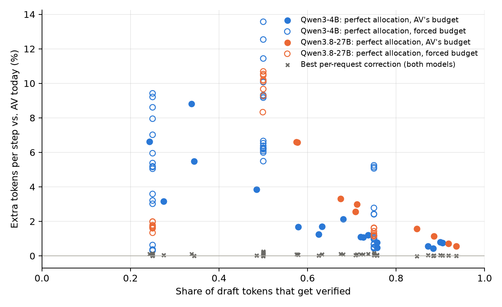

<div class="entry-byline" markdown>
[{ .entry-avatar }](https://github.com/tomasruizt)
**[@tomasruizt](https://github.com/tomasruizt)** posted on **2026-11-20**
</div>

# How much better could adaptive verification pick which drafts to verify? (@tomasruizt)

Joint work with [Shubhra Pandit](https://github.com/shubhra).

## Summary

Adaptive verification (AV) does not verify every draft token. Each step it estimates how likely each draft is to be accepted, and sends only the most promising ones to the target model. We asked two questions:

1. If AV's estimate were perfect, how many more tokens would it accept per step, at the same cost?
2. Can adding per-request uncertainty to the estimate recover some of that gain? The idea: give extra slots to requests we know little about, to find out whether their later drafts would be accepted.

What we found:

- **A perfect estimate would add little in most settings:** under 3.5% more tokens per step when AV already verifies 60% to 90% of the drafts.
- **The gain grows when AV has to cut more drafts:** +6.6% for Qwen3.8-27B at concurrency 256, and +8.8% for Qwen3-4B at concurrency 512.
- **Per-request uncertainty recovers none of it.** Even knowing each request's true bias in advance would gain at most +0.2%. The estimate is not systematically wrong about some requests. It is wrong about individual drafts, and those misses look random from one step to the next.
- **The remaining gain is mostly out of reach.** It would need better signals about each individual draft, and losslessness limits those hard. For sampling to stay lossless, the decision to verify a draft must not depend on the drafted token itself, a constraint that goes back to the DSpark paper (see also [vllm#52228](https://github.com/vllm-project/vllm/pull/52228)). AV may only use the drafter's distribution before the token is drawn, which the estimator already does through the drafter's confidence. The signal that would close the gap, whether the target agrees with the drafted token, is exactly what verification computes.



Each point is one model, dataset and concurrency. Filled circles use the number of drafts AV actually chose to verify. Hollow circles force that number to 25%, 50% or 75% of the drafts, to show what happens when the budget is tighter. The gray crosses (near zero) are the best per-request correction at the same budgets.

## Background

How AV picks drafts today ([vllm#52228](https://github.com/vllm-project/vllm/pull/52228)): for every draft token, an online estimator predicts the chance that the target accepts it, from the drafter's own confidence. A draft only counts if all drafts before it in the same request are accepted too, so AV multiplies these chances along each request. It then verifies the B most promising drafts in the batch, where B comes from a cost model.

Shubhra first tried adding an uncertainty bonus to the estimator ([shubhra/vllm#1](https://github.com/shubhra/vllm/pull/1)) and saw no change in throughput or acceptance. That bonus was the same for every request and shrank to almost zero after the first step, so it never changed which requests got verified. A per-request version looked more promising: a request that only ever gets 1 or 2 drafts verified never shows whether its later drafts would have been accepted, so the estimator could stay wrong about it.

## How we measured it

1. **Find out what would have been accepted.** We ran vLLM in a mode that verifies every draft, while still logging what AV would have chosen. At temperature 0 this tells us, for every request and step, how many drafts would have been accepted at any verification length.
2. **Replay offline.** Step by step, with the same number of verified drafts that AV chose (so the same step cost), we compared:
   - **AV today.**
   - **Perfect allocation:** knows in advance how many drafts each request will accept.
   - **Per-request strategies:** learn a correction for each request from the drafts they verified, either used directly or with exploration (UCB, Thompson sampling). Like the real system, they only learn from what they verify. All of them keep sampling lossless: they never look at the drafted token they are deciding about.
   - **Best per-request correction:** each request's correction fitted afterwards on its complete history. No per-request strategy can beat it.
3. **Check the replay.** On a normal AV run, replaying "AV today" reproduces AV's real decisions in 99.8% of steps or more.

We report tokens produced per step, relative to AV today. The step cost is the same, so this is the most throughput a better allocation could add.

## Results

Mixed prompts (all 9 subsets of `RedHatAI/speculator_benchmarks`), temperature 0:

| Model                      | Concurrency | Drafts AV verifies | Perfect allocation | Best per-request correction |            UCB |       Thompson |
| -------------------------- | ----------: | -----------------: | -----------------: | --------------------------: | -------------: | -------------: |
| Qwen3.8-27B (TP2)          |         128 |                68% |              +3.3% |                       +0.1% |          -0.1% |          -0.3% |
| Qwen3.8-27B (TP2)          |         256 |                58% |          **+6.6%** |                       +0.1% |          -0.1% |          -0.3% |
| Qwen3-4B                   |          64 |                28% |              +3.2% |                       +0.1% |          -0.0% |          -0.2% |
| Qwen3-4B                   |         128 |                76% |              +0.5% |                       +0.0% |          -0.0% |          -0.1% |
| Qwen3-4B                   |         256 |                76% |              +0.8% |                       +0.1% |          -0.0% |          -0.1% |
| Qwen3-4B                   |         512 |                34% |          **+8.8%** |                       +0.1% |          -0.1% |          -0.4% |
| Both, budget forced to 50% |   64 to 512 |                50% |        +9% to +11% |              +0.1% to +0.2% | -0.2% to -0.0% | -0.5% to -0.4% |

The 27B served 86 and 128 requests on average at concurrency 128 and 256 (KV cache limit). The Qwen3-4B row at 512 includes vLLM's limit on how many tokens can be verified per step (see below).

Earlier runs with single datasets (HumanEval, math_reasoning, writing) and with thinking off show the same pattern: +0.4% to +3% when AV verifies most drafts, up to +6.6% when it verifies fewer than half, and at most +0.3% for any per-request strategy, even with a forced budget.

**Why per-request uncertainty does not help.** Compared to the estimate, requests differ only slightly in how often their drafts are accepted: a standard deviation of 1 to 5 percentage points across requests. And a request's error at one step says almost nothing about its error at the next step (correlation 0.01 to 0.05). There is nothing per request to learn or to explore.

## Other things we learned

- **CUDA graphs.** On Blackwell, vLLM captures graphs up to 1,024 tokens by default. A step that verifies more tokens runs without graphs and is much more expensive, which also distorts AV's cost model. We captured graphs up to `max_num_seqs x (K+1)` tokens in all runs above.
- **A hidden cap on AV's budget.** The rejection sampler holds target logits in a 1 GB buffer, so AV can verify at most about 1 GB / (vocab size x 4 bytes) tokens per step: 1,766 for Qwen3-4B and 1,081 for Qwen3.8-27B. For Qwen3-4B at concurrency 512 this cap, not the cost model, decides how many drafts AV verifies (34% instead of 68%).
- **The estimator stays calibrated** even though it only learns from the drafts AV verifies: predicted and observed acceptance agree within 0.6 percentage points at every position.
- **The drafter's confidence is fully used.** A more flexible calibration of the same signal gains nothing (-0.1% to +0.0%).

## Limitations

- The replay assumes each request produces the same drafts it produced in the verify-all run. A different allocation would change what gets drafted next.
- We measure tokens per step at equal cost, not end-to-end throughput.
- Only temperature 0, B200 GPUs, DFlash2 drafters and two dense Qwen targets. We did not test DSpark or its trained confidence head, other GPUs, or MoE targets.

## Next steps

Few lossless signals are left to try. The candidates are other summaries of the drafter's distribution (entropy, top-2 margin) combined with its confidence, and the target model's entropy at the last accepted token, which is known before drafting. [vllm#52228](https://github.com/vllm-project/vllm/pull/52228) found that entropy and top-2 margin alone do not beat the drafter's confidence, so we expect small gains at best. They can be tested cheaply on these traces in the settings with headroom (Qwen3.8-27B at concurrency 256, Qwen3-4B at concurrency 512). Signals that look at the drafted token rank better, but break losslessness and are ruled out.

## Setup and reproduction

<details markdown>
<summary>Setup</summary>

- Targets: `Qwen/Qwen3-4B` and `Qwen/Qwen3.8-27B` (BF16). Drafters: `RedHatAI/Qwen3-4B-speculator.dflash2` (8 draft tokens) and `RedHatAI/Qwen3.8-27B-speculator.dflash2` (7 draft tokens), AV on.
- Data: all 9 subsets of `RedHatAI/speculator_benchmarks` (924 prompts) shuffled with `random.Random(0)`, thinking on, max 1,024 output tokens, 4 x concurrency requests per run.
- vLLM main `89e860de00` (2026-11-17) plus a trace patch: branch [`av-alloc-headroom`](https://github.com/tomasruizt/vllm/tree/av-alloc-headroom) (`3138435083`). `AV_TRACE_VERIFY_ALL=1` verifies every draft, `AV_TRACE_MAX_CHUNK_BYTES` lifts the 1 GB buffer limit so the verify-all runs are complete.
- Client: AIPerf 0.12.0. Hardware: NVIDIA B200 (183 GB), PyTorch 2.14.0+cu132.

</details>

<details markdown>
<summary>Commands</summary>

```bash
AV_TRACE_PATH=trace.jsonl AV_TRACE_VERIFY_ALL=1 AV_TRACE_MAX_CHUNK_BYTES=8589934592 \
vllm serve Qwen/Qwen3.8-27B --max-model-len 16384 --max-num-seqs 256 --tensor-parallel-size 2 \
  --max-num-batched-tokens 16384 --gpu-memory-utilization 0.85 --no-enable-prefix-caching \
  --speculative-config '{"model":"RedHatAI/Qwen3.8-27B-speculator.dflash2","num_speculative_tokens":7,"method":"dflash","enable_adaptive_verification":true}' \
  --default-chat-template-kwargs '{"enable_thinking": true}' \
  --compilation-config '{"max_cudagraph_capture_size": 2048}'

AV_TRACE_PATH=trace.jsonl AV_TRACE_VERIFY_ALL=1 AV_TRACE_MAX_CHUNK_BYTES=8589934592 \
vllm serve Qwen/Qwen3-4B --max-model-len 16384 --max-num-seqs 512 \
  --max-num-batched-tokens 16384 --gpu-memory-utilization 0.85 --no-enable-prefix-caching \
  --speculative-config '{"model":"RedHatAI/Qwen3-4B-speculator.dflash2","num_speculative_tokens":8,"method":"dflash","enable_adaptive_verification":true}' \
  --default-chat-template-kwargs '{"enable_thinking": true}' \
  --compilation-config '{"max_cudagraph_capture_size": 4608}'

aiperf profile --model Qwen/Qwen3-4B --tokenizer Qwen/Qwen3-4B --url http://127.0.0.1:8000 \
  --endpoint-type chat --streaming --input-file mixed.jsonl --custom-dataset-type single_turn \
  --dataset-sampling-strategy sequential --concurrency 512 --request-count 2048 \
  --extra-inputs max_tokens:1024 --extra-inputs temperature:0
```

Drop `AV_TRACE_VERIFY_ALL=1` for the normal AV run that checks the replay. `mixed.jsonl` holds one `{"text": prompt}` per line.

</details>

## References

- [vllm-project/vllm#52228](https://github.com/vllm-project/vllm/pull/52228): the online acceptance estimator
- [vllm-project/vllm#51303](https://github.com/vllm-project/vllm/issues/51303): adaptive verification tracking issue
- [shubhra/vllm#1](https://github.com/shubhra/vllm/pull/1): the first uncertainty experiment
- [DFlash adaptive verification on Qwen3.5-35B-A3B: CUDA graph capture sizes](dflash-adaptive-verification-cuda-graphs-tomasruizt.md)
