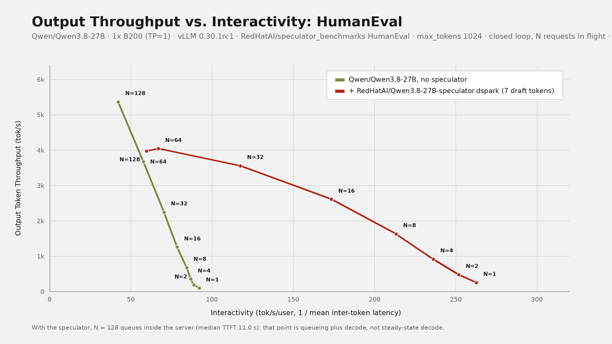
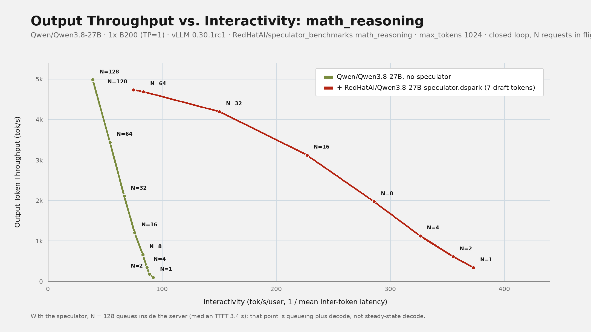
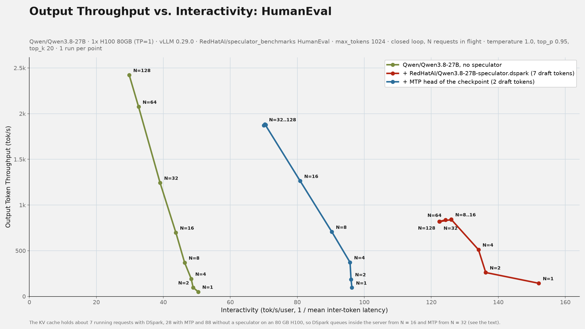
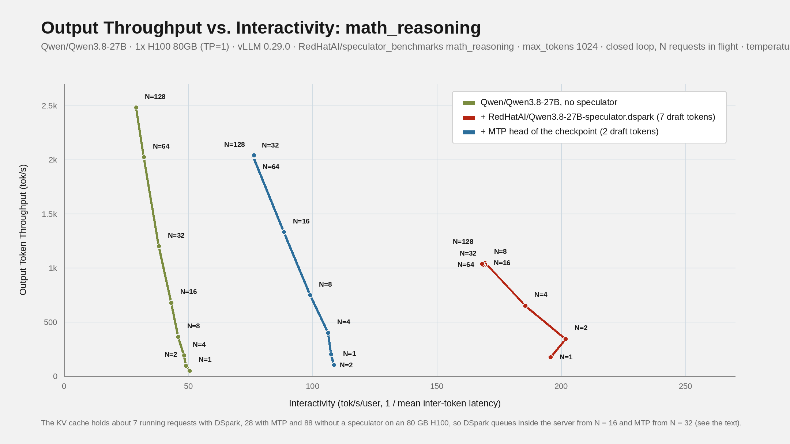

# Throughput vs. Interactivity

The chart compares total output tokens/s with each user's decode speed over a concurrency sweep. Collect each configuration with `speculators evaluate speedup`, then plot its timed GuideLLM JSON results using `scripts/evaluate/throughput_interactivity.py plot`. Dataset and acceptance options are described in [Evaluating Model Performance](evaluating_performance.md).

## What the chart shows

- **Y:** GuideLLM's native total output-token throughput during the measurement window.
- **X:** `1 / mean TPOT (seconds)`, calculated from token-normalized decode times for successful requests completed inside the window. Each request has equal weight; responses with at most one output token are excluded. Stream chunks can contain several tokens, so raw chunk gaps are not used.

Each marker is labelled with concurrency N. Higher and farther right is better. Compare configurations at the same throughput or interactivity. At low N a speculator can improve each user's decode speed; at high N the verifier is already busy and the gain often shrinks.

## Collect and plot

Serve each configuration with identical hardware and scheduler settings, prefix caching disabled, and the same generation settings. Speedup uses GuideLLM's concurrent profile with a time limit. The default per point is 30 seconds of warmup followed by 100 seconds of measurement, plus client setup and teardown. Requests still in flight at the deadline are recorded as incomplete. The wrapper uses native window throughput and does not implement token prorating or a custom scheduler.

```bash
speculators evaluate speedup \
  --dataset humaneval --target http://localhost:8010 --model my-model \
  --max-tokens 1024 --streams 1,2,4,8,16,32,64,128 \
  --warmup-seconds 30 --max-seconds 100 --repeats 3 \
  --output-dir runs/dspark_humaneval --label dspark

# Repeat against the baseline server, changing --output-dir and --label.
python scripts/evaluate/throughput_interactivity.py plot \
  --series runs/baseline_humaneval:Baseline \
  --series runs/dspark_humaneval:DSpark \
  --title 'HumanEval' --out humaneval.png
```

The full selection is available as a repeated prompt pool; the timer ends the point without consuming the entire pool. `--dataset-repeat` can increase the pool if it is exhausted. Time limits do not guarantee every source row is visited. Record dataset revisions, GuideLLM/vLLM versions, generation budgets, time budgets, and server settings with results. Use `--guidellm-bin` for a client in another environment and `--tokenizer` when the served alias differs from the verifier tokenizer. MRCR remains acceptance-only.

The example `examples/evaluate/example_qwen3_8_27b_dspark_throughput_interactivity.sh` launches baseline, DSpark, and MTP configurations and draws one chart per dataset. The charts below are historical GuideLLM measurements; their server settings and custom historical token-window calculation differ from current runs.

## Choosing concurrency

Keep scheduler limits identical and choose `--max-num-seqs` at least as large as the largest N when comparing decode capacity. Larger prefill budgets can trade decode latency for throughput. Once the server cannot hold N requests, queueing and KV-cache capacity also affect the curve. Run on a quiet machine and check GPU clocks when investigating a regression.

## What the example produces

Two charts, one per dataset, with the plain model, the DSpark speculator (7 draft tokens) and the checkpoint's MTP head (2 draft tokens). These were measured on one B200 per server with vLLM 0.30.1rc1 and GuideLLM 0.8.0, one run per point, before the example turned off prefix caching, so their prefill was partly served from cache; your numbers will differ with hardware, vLLM version and server flags, the current example records the evaluation command in `eval_command.txt` and server commands in the serve logs.





How to read them: at one request in flight, DSpark gives each user about three times the plain model's speed on HumanEval and four times on math_reasoning, in line with its acceptance length; MTP with 2 draft tokens gives about two times. Moving left, every gain shrinks as the verifier batch fills, and the curves cross: with these settings DSpark delivers the most throughput wherever each user must get more than roughly 100 to 125 tok/s, while MTP's cheaper drafts deliver the most output per GPU at lower per-user speeds and never queue. Pick the per-user speed you must guarantee, read the throughput each configuration gives at it, and that is the comparison that matters for a deployment. The old validator flagged DSpark's N = 128 points as queueing inside the server: with the drafter loaded, the KV cache on one B200 held about 74 requests, so that point measures queueing plus decode.

### The same three configurations on an H100

The same procedure on one H100 80GB per server, with vLLM 0.29.0 and GuideLLM 0.8.0, prefix caching off, one run per point, and every request sent with the model's default sampling (temperature 1.0, top-p 0.95, top-k 20, the values in its `generation_config.json`, passed with `--extra-body` so that all three servers see the same):





At one request in flight the picture matches the B200: DSpark gives each user 3.0 times the plain model's speed on HumanEval and 3.9 times on math_reasoning, MTP with 2 draft tokens 2.0 and 2.1 times. The right side of the chart is different, and the cause is the KV cache, not the drafter. Qwen3.8-27B is a hybrid model whose 48 linear-attention layers keep about 160 MB of recurrent state per request, and vLLM holds one copy of that state per draft token so it can roll back rejected drafts (`1 + num_speculative_tokens` copies). A request therefore costs about 0.2 GB of KV cache without a speculator, 0.55 GB with MTP and 1.4 GB with DSpark. After the weights, an 80 GB H100 leaves 17 GiB of KV cache to the plain server, 15 GiB to MTP and 10 GiB to DSpark, so the three servers hold about 88, 28 and 7 running requests. Past that, the old validator reported the queueing check (DSpark from N = 16, MTP from N = 32, the plain server at N = 128): throughput plateaus at about 1,000 tok/s for DSpark and 1,900 for MTP while the ITL-based interactivity stays flat, because once a request streams it is measured like any other, and the old Little's-law axis showed the same points with the queue wait counted against the user. On a B200 the same per-request cost leaves room for about 73 DSpark requests, which is why only its N = 128 point queued there. Both runs say the same thing about the drafters; the H100 run also says how much memory each configuration needs before concurrency, not the drafter, sets the throughput.

See [throughput_interactivity.py](../../cli/throughput_interactivity.md) for the full command-line reference and the result fields.
